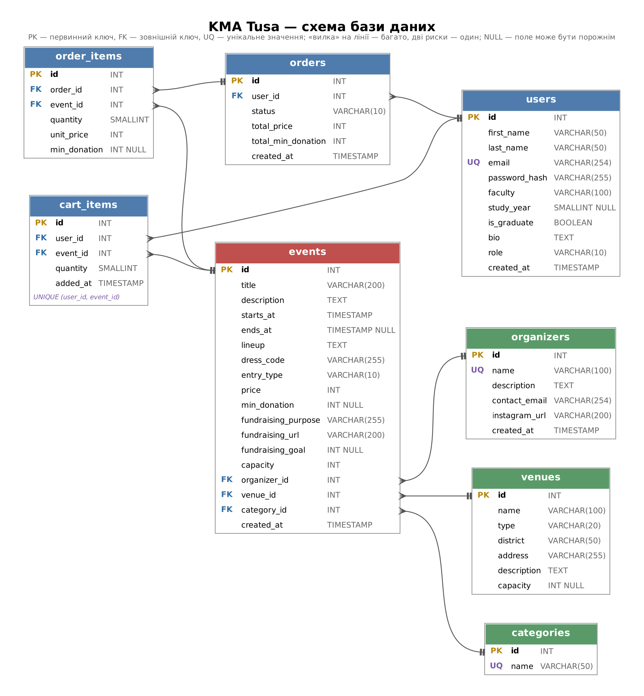

# KMA Tusa

> Афіша студентських тусовок Могилянки: вечірки, квартирники, «Бунтівники», ночі настолок і караоке. Знайди й обери, куди піти, за кілька кліків.


## Зміст

- [Про проєкт](#про-проєкт)
- [Сторінки сайту](#сторінки-сайту)
- [Ролі користувачів](#ролі-користувачів)
- [Як запустити проєкт](#як-запустити-проєкт)
- [Змінні середовища](#змінні-середовища)
- [Тести](#тести)
- [Документація API (Swagger)](#документація-api-swagger)
- [Логування](#логування)
- [REST API](#rest-api)
  - [Загальні правила](#загальні-правила)
  - [Формат помилок](#формат-помилок)
  - [Обмеження предметної області](#обмеження-предметної-області)
  - [Перелік ендпоінтів](#перелік-ендпоінтів)
  - [Авторизація і права доступу](#авторизація-і-права-доступу)
  - [Категорії](#категорії)
  - [Організатори](#організатори)
  - [Локації](#локації)
  - [Тусовки](#тусовки)
  - [Заплановані ендпоінти](#заплановані-ендпоінти)
- [Postman-колекція](#postman-колекція)
- [Схема бази даних](#схема-бази-даних)
- [TODO / TBD](#todo--tbd)
- [Плани розвитку](#плани-розвитку)
- [Автор](#автор)

## Про проєкт

Студенти Могилянки постійно влаштовують вечірки, квартирники, (колись повернеться) «Бунтівник» та інші зібрання, щоб відпочити після пар. Але дізнатися про них можна лише випадково: з історії в Instagram, з репосту в Telegram-чаті або від друга, який «чув, що в суботу щось буде». Організаторам, своєю чергою, складно зібрати людей і порахувати, скільки їх прийде.

**KMA Tusa** це одне місце для всіх студентських тусовок:

- студент бачить **афішу** найближчих тусовок, може знайти потрібну за назвою чи організатором і відфільтрувати за типом (вечірка, квартирник, настолки…), датою, локацією, умовами входу та іншими параметрами;
- на сторінці тусовки є все, що треба знати перед тим, як іти: опис, дата й час, хто грає або виступає (лайнап), дрес-код, умови входу, посилання на збір, організатори і скільки ще залишилося місць;
- більшість тусовок у Могилянці **благодійні** (вхід за донат на збір для ЗСУ чи іншої ініціативи) або **безкоштовні**, а платний квиток трапляється рідше. Тому в кожної тусовки вказано тип входу: *вільний*, *за донат* або *квиток*. Для благодійних тусовок показано мету збору й посилання на банку. Сайт сам гроші не приймає: донат робиться за посиланням на збір;
- можна переглянути **організаторів** і всі їхні тусовки;
- можна переглянути **локації** і всі тусовки, що там проходять;
- зареєстрований користувач додає квитки в **кошик** (наприклад, на кілька тусовок одразу або кілька квитків для друзів) і оформлює **замовлення**. «Квиток» тут означає місце на тусовці, а не обов'язково платний вхід. У першій версії оплати немає: натискання «Оформити» одразу створює замовлення. Безкоштовні та благодійні тусовки теж оформлюються через замовлення, щоб організатор знав, скільки людей прийде;
- у **профілі** користувач бачить історію замовлень (куди він іде і де вже був) та може редагувати дані про себе;
- адміністратор додає, редагує та видаляє тусовки, організаторів, локації й категорії.

## Сторінки сайту

| Сторінка | Що на ній є |
|---|---|
| **Афіша** (головна) | Список тусовок, пошук за назвою та організатором, фільтри (категорія, організатор, локація, район, дата, тип входу, лише благодійні), сортування (найближчі, популярні, за категорією) |
| **Сторінка тусовки** | Обкладинка, назва, опис, дата й час початку/кінця, лайнап, дрес-код, тип входу (вільний / за донат / квиток) і сума, мета збору й посилання на нього, локація, організатор, категорія, кількість вільних місць, кнопка «Додати в кошик» |
| **Організатори** | Список усіх організаторів з пошуком |
| **Сторінка організатора** | Опис, логотип, контакти, Instagram, усі тусовки цього організатора |
| **Локації** | Список місць, де проходять тусовки |
| **Сторінка локації** | Тип, район, адреса, опис, місткість, усі тусовки в цій локації |
| **Реєстрація / Вхід** | Форми реєстрації та входу |
| **Профіль** | Дані користувача (ім'я, факультет, курс/випускник, щось про себе) з можливістю редагування, історія замовлень |
| **Кошик** | Квитки, додані користувачем, зміна кількості, видалення, загальна сума за квитки та мінімальних донатів, кнопка «Оформити» |
| **Про нас** | Загальна інформація, правила відвідування, контакти |
| **Адмін-панель** | Форми додавання, редагування та видалення тусовок, організаторів, локацій, категорій |

## Ролі користувачів

| Роль | Що може |
|---|---|
| Гість | Переглядати афішу, тусовки, організаторів, локації, сторінку «Про нас»; зареєструватися або увійти |
| Користувач | Усе, що гість, а також додавати, редагувати й видаляти тусовки та організаторів; надалі кошик, замовлення, профіль |
| Адміністратор | Усе, що користувач, а також додавати, редагувати й видаляти категорії та локації |

Роль визначається за токеном у запиті: без токена це гість, з токеном користувач, а адміністратор має прапорець `is_staff`. Детально в розділі [Авторизація і права доступу](#авторизація-і-права-доступу).

## Як запустити проєкт

Потрібен Python 3.12, 3.13 або 3.14. Усі команди виконуються в папці, де лежить `manage.py`.

1. Склонуйте репозиторій:

   ```bash
   git clone https://github.com/Jorjio0/kma-tusa.git
   cd kma-tusa
   ```

2. Створіть і активуйте віртуальне середовище:

   ```bash
   python -m venv .venv

   # Windows (PowerShell)
   .venv\Scripts\activate
   # Linux / macOS
   source .venv/bin/activate
   ```

3. Встановіть залежності:

   ```bash
   python -m pip install -r requirements-dev.txt
   ```

   `requirements.txt` містить те, що потрібно серверу (Django, Django REST framework, django-cors-headers, djangorestframework-simplejwt, drf-spectacular, python-decouple), а `requirements-dev.txt` ще й інструменти перевірки коду та тестів (ruff, pytest, pytest-django, pytest-cov).

4. Створіть файл `.env` з налаштуваннями (див. [Змінні середовища](#змінні-середовища)):

   ```bash
   # Windows (PowerShell)
   Copy-Item .env.example .env
   # Linux / macOS
   cp .env.example .env
   ```

   Згенеруйте свій `SECRET_KEY` і вставте його в `.env` замість `change-me-to-a-long-random-string`:

   ```bash
   python -c "from django.core.management.utils import get_random_secret_key; print(get_random_secret_key())"
   ```

5. Створіть базу даних:

   ```bash
   python manage.py migrate
   ```

6. Завантажте демо-дані (6 категорій, 4 організатори, 6 локацій, 8 тусовок) і двох демо-користувачів:

   ```bash
   python manage.py loaddata demo users
   ```

   | Логін | Пароль | Роль |
   |---|---|---|
   | `tusa_admin` | `TusaAdmin2026` | адміністратор |
   | `tusa_student` | `TusaStudent2026` | користувач |

7. Запустіть сервер:

   ```bash
   python manage.py runserver
   ```

   API доступне за адресою **http://127.0.0.1:8000/api/**, наприклад [http://127.0.0.1:8000/api/events/](http://127.0.0.1:8000/api/events/).

8. *(Необов'язково)* Створіть власного адміністратора. Він зможе входити і в API, і в адмінку Django (http://127.0.0.1:8000/admin/):

   ```bash
   python manage.py createsuperuser
   ```

Перевірка стилю коду (PEP 8, форматування) перед комітом:

```bash
python check_submission.py           # перевірити
python check_submission.py --format  # автоматично виправити форматування
```

### Адреси та порти

| Що | Адреса |
|---|---|
| Бекенд (API) | http://127.0.0.1:8000/api/ |
| Адмінка Django | http://127.0.0.1:8000/admin/ |
| Документація API (Swagger UI) | http://127.0.0.1:8000/api/docs/ |
| Документація API (ReDoc) | http://127.0.0.1:8000/api/redoc/ |
| OpenAPI-схема (YAML) | http://127.0.0.1:8000/api/schema/ |
| Фронтенд ([окремий репозиторій](https://github.com/Jorjio0/kma-tusa-frontend)) | http://localhost:5173 |

Бекенд приймає запити з браузера (CORS) лише з адрес фронтенду: `http://localhost:5173` і `http://127.0.0.1:5173`. Список задано змінною `CORS_ALLOWED_ORIGINS` у `.env`.

## Змінні середовища

Секретні й залежні від середовища налаштування не зберігаються в коді: `config/settings.py` читає їх з файлу `.env` через [python-decouple](https://pypi.org/project/python-decouple/). Файл `.env` додано в `.gitignore`, тому він не потрапляє в Git. У репозиторії лежить лише `.env.example` із заглушками.

| Змінна | Обов'язкова | Приклад | Що означає |
|---|:---:|---|---|
| `SECRET_KEY` | так | довгий випадковий рядок | Ключ Django для підписів, зокрема JWT-токенів. Без нього сервер не запуститься |
| `DEBUG` | ні (`False`) | `True` | Режим розробки: детальні сторінки помилок і browsable API |
| `ALLOWED_HOSTS` | ні (`localhost,127.0.0.1`) | `localhost,127.0.0.1` | Хости, з яких Django приймає запити, через кому |
| `CORS_ALLOWED_ORIGINS` | ні (порт 5173) | `http://localhost:5173,http://127.0.0.1:5173` | Адреси фронтенду, яким дозволено звертатися до API з браузера |
| `LOG_LEVEL` | ні (`INFO`) | `DEBUG` | Рівень логування застосунків `events` і `accounts` |

## Тести

Тести написані на **pytest** з плагіном **pytest-django**, запити до API надсилає `APIClient` з Django REST framework. Для тестів створюється окрема тимчасова база, тому робоча `db.sqlite3` не змінюється.

```bash
python -m pip install -r requirements-dev.txt   # якщо ще не встановлено
pytest                                          # запустити всі тести
pytest -v                                       # з назвою кожного тесту
pytest --cov --cov-report=term-missing          # з відсотком покриття
```

Для тестів потрібен файл `.env` (див. [Змінні середовища](#змінні-середовища)).

Що покрито:

- **Тусовки** (`events/tests/test_events_api.py`), усі методи `GET`, `POST`, `PUT`, `DELETE`:
  - позитивні сценарії: список, тусовка за id, створення, оновлення й видалення залогіненим користувачем;
  - негативні сценарії: `401` без токена й з невалідним токеном, `400` для порожнього тіла й порушених бізнес-правил, `404` для неіснуючої тусовки, `405` для `PATCH`.
- **Ролі** (`events/tests/test_roles_api.py`): категорії й локації змінює лише адміністратор (`401` для гостя, `403` для користувача, `201`/`200` для адміністратора), `400` для дубліката назви, `409` при видаленні категорії з тусовками.
- **Авторизація** (`accounts/tests/test_auth_api.py`): реєстрація (пароль зберігається хешем) та її помилки, вхід, неправильний пароль, оновлення токена, `/api/auth/me/`.

Тестові дані готують **фікстури** pytest у `conftest.py` (у корені проєкту): `api_client`, користувачі `user` і `admin_user`, клієнти з токеном `user_client` і `admin_client` (входять через `/api/auth/login/`), об'єкти `category`, `organizer`, `venue`, `event` і тіло запиту `event_data`.

Покриття рахує **pytest-cov** (coverage.py). Налаштування в `.coveragerc`: міграції, самі тести й службові файли не враховуються.

## Документація API (Swagger)

Документація генерується автоматично з коду за стандартом **OpenAPI 3** за допомогою [drf-spectacular](https://drf-spectacular.readthedocs.io/).

- **Swagger UI:** http://127.0.0.1:8000/api/docs/
- **ReDoc:** http://127.0.0.1:8000/api/redoc/
- **OpenAPI-схема (YAML):** http://127.0.0.1:8000/api/schema/, або файлом: `python manage.py spectacular --file schema.yml`

У Swagger UI видно всі ендпоінти, методи, параметри, структуру запитів і відповідей. Ресурс **тусовок** (`/api/events/`) задокументовано детально: опис кожної дії, вимоги до автентифікації, можливі статуси (`200`, `201`, `204`, `400`, `401`, `404`) і приклади запиту та відповідей.

Щоб виконати захищений запит прямо зі Swagger UI:

1. Виконайте `POST /api/auth/login/` (кнопка **Try it out**).
2. Скопіюйте `access` з відповіді.
3. Натисніть **Authorize** угорі сторінки і вставте токен.

## Логування

Логи виводяться в консоль, де запущено сервер, у форматі `час рівень модуль: повідомлення`. Налаштування в `LOGGING` у `config/settings.py`, рівень задає змінна `LOG_LEVEL`.

| Рівень | Що записується |
|---|---|
| `INFO` | Успішні дії: створення, оновлення й видалення записів (id і хто виконав), реєстрація, вхід користувача |
| `WARNING` | Відхилені дії: помилки валідації (лише назви полів, без значень), запис не знайдено, видалення заборонено через пов'язані тусовки (`409`), невдала спроба входу |

Паролі, токени та значення полів у логи не записуються.

Приклад:

```
2026-11-18 07:43:20,575 WARNING accounts.views: Невдала спроба входу для користувача tusa_admin
2026-11-18 07:43:20,585 WARNING events.views: Тусовку id=999 не знайдено
```

## REST API

### Загальні правила

- Усі адреси починаються з `/api/` і **закінчуються слешем**: `/api/events/`, `/api/events/3/`.
- Дані передаються у форматі **JSON** (`Content-Type: application/json`).
- Назви полів у **snake_case** (`starts_at`, `entry_type`), так само як у моделях Django.
- Списки повертаються **простим масивом**, без пагінації, відсортованими: категорії, організатори й локації за назвою, тусовки за часом початку.
- Зв'язки передаються як **id**: `"organizer": 1`, `"venue": 2`, `"category": 3`.
- Методи:

  | Метод | Адреса | Що робить | Успіх |
  |---|---|---|---|
  | `GET` | `/api/<ресурс>/` | список | `200 OK`, масив |
  | `POST` | `/api/<ресурс>/` | створити запис | `201 Created`, створений об'єкт з `id` |
  | `GET` | `/api/<ресурс>/{id}/` | один запис | `200 OK` |
  | `PUT` | `/api/<ресурс>/{id}/` | оновити запис (передаються всі обов'язкові поля) | `200 OK`, оновлений об'єкт |
  | `DELETE` | `/api/<ресурс>/{id}/` | видалити запис | `204 No Content`, тіло порожнє |

- Дата й час у форматі ISO 8601 за київським часом: `"2026-11-14T21:00:00+02:00"`. Можна передавати й без часового поясу (`"2026-11-14T21:00"`), тоді час вважається київським.
- Суми в цілих гривнях, числом: `150`.
- Необов'язкові текстові поля повертаються як порожній рядок `""`, а необов'язкові числа й дати як `null`.
- **Доступ.** Читати (`GET`) можуть усі. Щоб створювати, редагувати й видаляти, потрібен токен у заголовку `Authorization: Bearer <access>`, а для категорій і локацій ще й роль адміністратора. Див. [Авторизація і права доступу](#авторизація-і-права-доступу).

#### Тип входу на тусовку

Кожна тусовка має поле `entry_type`, від якого залежать інші поля:

| `entry_type` | Що означає | `price` | `min_donation` | `fundraising_url` |
|---|---|---|---|---|
| `free` | Вхід вільний | `0` | не вказується | необов'язково (можна задонатити за бажанням) |
| `donation` | Вхід за донат на збір | `0` | мінімальний донат або `null` (будь-який) | **обов'язково** |
| `ticket` | Платний квиток | більше `0` | не вказується | необов'язково (наприклад, частина коштів іде на збір) |

Збір описують поля `fundraising_purpose` (мета), `fundraising_url` (посилання на банку) і `fundraising_goal` (ціль у гривнях, необов'язково). Сайт не приймає гроші: донат робиться за посиланням.

### Формат помилок

Формат однаковий для всіх ендпоінтів (це стандартні формати Django REST framework):

**`400 Bad Request`** — дані не пройшли перевірку. Ключ — назва поля, значення — список повідомлень, щоб фронтенд міг показати їх під потрібним полем форми:

```json
{
  "ends_at": [
    "Час завершення має бути пізніше за час початку."
  ],
  "price": [
    "Ціну вказують лише для платного квитка."
  ],
  "fundraising_url": [
    "Для тусовки за донат вкажіть посилання на збір."
  ],
  "capacity": [
    "Локація вміщує лише 200 людей."
  ]
}
```

**`401`, `403`, `404`, `405`, `409`** — пояснення в полі `detail`:

```json
{
  "detail": "Неможливо видалити категорію Вечірка: у ній є тусовки (3). Спершу перенесіть їх в іншу категорію."
}
```

| Код | Коли повертається |
|---|---|
| `400 Bad Request` | Дані не пройшли перевірку: не заповнені обов'язкові поля, неправильний формат, порушені правила тусовки, тіло не є JSON |
| `401 Unauthorized` | Немає токена, токен невалідний або прострочений; неправильний логін чи пароль при вході |
| `403 Forbidden` | Користувач увійшов, але його ролі не вистачає прав (наприклад, не адміністратор змінює категорію) |
| `404 Not Found` | Запису з таким `id` немає |
| `405 Method Not Allowed` | Ендпоінт не підтримує цей метод (наприклад, `PATCH`) |
| `409 Conflict` | Запис не можна видалити, бо з ним пов'язані тусовки |

**Чому 400, а коли 409.** `400` означає, що неправильні самі дані в запиті: порожня або вже зайнята назва, невідомий тип локації, ціна для безкоштовної тусовки. Їх треба виправити. `409` означає, що запит правильний, але суперечить поточному стану бази: видалити організатора можна, але не поки за ним закріплені тусовки. Якщо спершу видалити чи перенести ці тусовки, той самий запит виконається успішно.

### Обмеження предметної області

| Ситуація | Відповідь |
|---|---|
| Видалення категорії, у якій є тусовки | `409`, у повідомленні кількість тусовок і що зробити |
| Видалення організатора, за яким закріплені тусовки | `409` |
| Видалення локації, у якій заплановані тусовки | `409` |
| Категорія чи організатор з уже зайнятою назвою | `400` |
| Тип входу не відповідає ціні, мінімальному донату чи збору (див. [Тип входу](#тип-входу-на-тусовку)) | `400` |
| Час завершення тусовки раніше за час початку | `400` |
| Місткість тусовки більша за місткість локації | `400` |
| Місткість тусовки чи локації менша за 1 | `400` |

### Перелік ендпоінтів

Колонка «Доступ»: хто може виконати запит (усі, залогінений користувач або адміністратор). Колонка «Готово»: ✅ уже реалізовано, ⏳ буде в наступних роботах. Вихід (logout) відбувається на клієнті, окремого ендпоінта немає.

| Метод | Ендпоінт | Опис | Доступ | Готово |
|---|---|---|---|:---:|
| `GET` | `/api/categories/` | Список категорій | усі | ✅ |
| `POST` | `/api/categories/` | Додати категорію | адміністратор | ✅ |
| `GET` | `/api/categories/{id}/` | Категорія за id | усі | ✅ |
| `PUT` | `/api/categories/{id}/` | Перейменувати категорію | адміністратор | ✅ |
| `DELETE` | `/api/categories/{id}/` | Видалити категорію | адміністратор | ✅ |
| `GET` | `/api/organizers/` | Список організаторів | усі | ✅ |
| `POST` | `/api/organizers/` | Додати організатора | користувач | ✅ |
| `GET` | `/api/organizers/{id}/` | Організатор за id | усі | ✅ |
| `PUT` | `/api/organizers/{id}/` | Редагувати організатора | користувач | ✅ |
| `DELETE` | `/api/organizers/{id}/` | Видалити організатора | користувач | ✅ |
| `GET` | `/api/venues/` | Список локацій | усі | ✅ |
| `POST` | `/api/venues/` | Додати локацію | адміністратор | ✅ |
| `GET` | `/api/venues/{id}/` | Локація за id | усі | ✅ |
| `PUT` | `/api/venues/{id}/` | Редагувати локацію | адміністратор | ✅ |
| `DELETE` | `/api/venues/{id}/` | Видалити локацію | адміністратор | ✅ |
| `GET` | `/api/events/` | Список тусовок | усі | ✅ |
| `POST` | `/api/events/` | Додати тусовку | користувач | ✅ |
| `GET` | `/api/events/{id}/` | Тусовка за id | усі | ✅ |
| `PUT` | `/api/events/{id}/` | Редагувати тусовку | користувач | ✅ |
| `DELETE` | `/api/events/{id}/` | Видалити тусовку | користувач | ✅ |
| `GET` | `/api/organizers/{id}/events/` | Тусовки організатора | усі | ⏳ |
| `GET` | `/api/venues/{id}/events/` | Тусовки в локації | усі | ⏳ |
| `POST` | `/api/auth/register/` | Реєстрація | усі | ✅ |
| `POST` | `/api/auth/login/` | Вхід, отримання `access` і `refresh` токенів | усі | ✅ |
| `POST` | `/api/auth/refresh/` | Новий `access` токен за `refresh` | усі | ✅ |
| `GET` | `/api/auth/me/` | Поточний користувач | користувач | ✅ |
| `PATCH` | `/api/auth/me/` | Редагування профілю | користувач | ⏳ |
| `GET` | `/api/cart/` | Вміст мого кошика | користувач | ⏳ |
| `POST` | `/api/cart/items/` | Додати квитки в кошик | користувач | ⏳ |
| `PATCH` | `/api/cart/items/{item_id}/` | Змінити кількість квитків | користувач | ⏳ |
| `DELETE` | `/api/cart/items/{item_id}/` | Прибрати позицію з кошика | користувач | ⏳ |
| `DELETE` | `/api/cart/` | Очистити кошик | користувач | ⏳ |
| `POST` | `/api/orders/` | Оформити замовлення з кошика | користувач | ⏳ |
| `GET` | `/api/orders/` | Історія моїх замовлень | користувач | ⏳ |
| `GET` | `/api/orders/{id}/` | Деталі замовлення | користувач | ⏳ |
| `PATCH` | `/api/orders/{id}/` | Скасувати замовлення | користувач | ⏳ |
| `GET` | `/api/info/` | Дані для сторінки «Про нас» | усі | ⏳ |

Нижче кожен реалізований ендпоінт описано детально (натисніть, щоб розгорнути). Приклади відповідей отримані від сервера з демо-даними.

---

### Авторизація і права доступу

Автентифікація зроблена на **JWT** (JSON Web Token) за допомогою бібліотеки [djangorestframework-simplejwt](https://django-rest-framework-simplejwt.readthedocs.io/). Користувачі зберігаються у вбудованій моделі Django `User` (таблиця `auth_user`), паролі зберігаються лише у вигляді хешу (`pbkdf2_sha256`). Код авторизації лежить в окремому застосунку `accounts`.

#### Як це працює

1. Користувач реєструється: `POST /api/auth/register/`.
2. Користувач входить: `POST /api/auth/login/`. Сервер повертає два токени:
   - **`access`** живе **5 хвилин**. Його надсилають з кожним запитом, якому потрібна авторизація;
   - **`refresh`** живе **1 добу**. Він потрібен лише для того, щоб отримати новий `access`.
3. Клієнт передає `access` у заголовку кожного запиту:

   ```
   Authorization: Bearer <access>
   ```

4. Коли `access` закінчується, сервер відповідає `401`. Клієнт надсилає `refresh` на `POST /api/auth/refresh/`, отримує новий `access` і повторює запит. Користувачу не треба знову вводити пароль.
5. Коли закінчується й `refresh`, користувач входить знову.
6. **Вихід (logout)** відбувається на клієнті: фронтенд видаляє збережені токени. Окремого ендпоінта для виходу немає, бо сервер не зберігає токени: він лише перевіряє їхній підпис і термін дії.

Строки життя токенів задані в `SIMPLE_JWT` у `config/settings.py`.

#### Ролі та права доступу

| Роль | Як визначається | Що може |
|---|---|---|
| Гість | запит без заголовка `Authorization` | читати (`GET`) усі ресурси; зареєструватися й увійти |
| Користувач | будь-який залогінений користувач | усе, що гість, а також створювати, редагувати й видаляти **тусовки** та **організаторів** |
| Адміністратор | користувач з `is_staff = True` (наприклад, створений через `createsuperuser`) | усе, що користувач, а також створювати, редагувати й видаляти **категорії** та **локації** |

| Ресурс | `GET` | `POST`, `PUT`, `DELETE` |
|---|---|---|
| `/api/events/`, `/api/organizers/` | усі | користувач, адміністратор |
| `/api/categories/`, `/api/venues/` | усі | лише адміністратор |
| `/api/auth/register/`, `/api/auth/login/`, `/api/auth/refresh/` | — | усі (`POST`) |
| `/api/auth/me/` | користувач, адміністратор | — |

Права задані атрибутом `permission_classes` у кожному view: вбудований `IsAuthenticatedOrReadOnly` для тусовок і організаторів та власний `IsAdminOrReadOnly` (`accounts/permissions.py`) для категорій і локацій.

**Відповіді без доступу:**

`401 Unauthorized` — токена немає, він невалідний або прострочений. Відповідь містить заголовок `WWW-Authenticate: Bearer realm="api"`:

```json
{
  "detail": "Реквізити перевірки достовірності не надані."
}
```

Для невалідного чи простроченого токена текст повідомлення формує simplejwt (англійською), а поле `code` дорівнює `token_not_valid`. Саме за цим кодом фронтенд розуміє, що треба оновити `access`:

```json
{
  "detail": "Given token not valid for any token type",
  "code": "token_not_valid",
  "messages": [
    {
      "token_class": "AccessToken",
      "token_type": "access",
      "message": "Token is invalid"
    }
  ]
}
```

`403 Forbidden` — користувач увійшов, але його ролі не вистачає прав, наприклад звичайний користувач створює категорію:

```json
{
  "detail": "Цю дію може виконати лише адміністратор."
}
```

**401 чи 403.** `401` означає, що сервер не знає, хто робить запит: треба увійти або оновити токен. `403` означає, що сервер знає користувача, але йому ця дія заборонена: повторний вхід не допоможе.

#### Демо-акаунти

Фікстура `accounts/fixtures/users.json` (`python manage.py loaddata users`) створює двох користувачів для перевірки. Паролі у фікстурі зберігаються захешованими. Акаунти призначені лише для локальної розробки.

| Логін | Пароль | Роль |
|---|---|---|
| `tusa_admin` | `TusaAdmin2026` | адміністратор |
| `tusa_student` | `TusaStudent2026` | користувач |

<details>
<summary><code>POST /api/auth/register/</code> — реєстрація</summary>

**Доступ:** усі. **Заголовки:** `Content-Type: application/json`.

**Request body:**

```json
{
  "username": "olena_koval",
  "first_name": "Олена",
  "last_name": "Коваль",
  "email": "olena.koval@ukma.edu.ua",
  "password": "Mohyla2026pass",
  "password_confirm": "Mohyla2026pass"
}
```

| Поле | Обов'язкове | Обмеження |
|---|:---:|---|
| `username` | так | до 150 символів; літери, цифри та `@ . + - _`; унікальне |
| `first_name` | ні | до 150 символів, можна не передавати або передати `""` |
| `last_name` | ні | до 150 символів, можна не передавати або передати `""` |
| `email` | так | коректний формат (`name@example.com`), до 254 символів, унікальний |
| `password` | так | від 8 до 128 символів; не схожий на username чи email, не з переліку поширених паролів, не лише з цифр |
| `password_confirm` | так | до 128 символів, має збігатися з `password` |

**Responses:**

`201 Created` — створений користувач (пароль у відповіді не повертається):

```json
{
  "id": 107,
  "username": "olena_koval",
  "first_name": "Олена",
  "last_name": "Коваль",
  "email": "olena.koval@ukma.edu.ua"
}
```

`400 Bad Request` — не заповнені обов'язкові поля:

```json
{
  "username": ["Це поле обов'язкове."],
  "email": ["Це поле обов'язкове."],
  "password": ["Це поле обов'язкове."],
  "password_confirm": ["Це поле обов'язкове."]
}
```

`400 Bad Request` — некоректний email і закороткий пароль:

```json
{
  "email": ["Введіть коректну адресу електронної пошти."],
  "password": ["Переконайтесь, що в цьому полі мінімум 8 символів."]
}
```

`400 Bad Request` — паролі не збігаються, пароль слабкий (`"password": "12345678"`):

```json
{
  "password_confirm": ["Паролі не збігаються."],
  "password": [
    "Пароль занадто поширений.",
    "Цей пароль повністю складається із цифр."
  ]
}
```

`400 Bad Request` — username або email уже зайняті:

```json
{
  "username": ["Користувач з таким ім'ям вже існує."],
  "email": ["Користувач з таким email вже існує."]
}
```

</details>

<details>
<summary><code>POST /api/auth/login/</code> — вхід, отримання токенів</summary>

**Доступ:** усі. **Заголовки:** `Content-Type: application/json`.

**Request body:**

```json
{
  "username": "olena_koval",
  "password": "Mohyla2026pass"
}
```

**Responses:**

`200 OK` (токени скорочено):

```json
{
  "refresh": "eyJhbGciOiJIUzI1NiIsInR5cCI6IkpXVCJ9.<payload>.<signature>",
  "access": "eyJhbGciOiJIUzI1NiIsInR5cCI6IkpXVCJ9.<payload>.<signature>"
}
```

У `payload` токена лежать `token_type` (`access` або `refresh`), `user_id`, `iat` (коли видано) та `exp` (коли закінчується). Payload не зашифрований, тому в токен не кладуть секретних даних. Підробити його не можна: підпис перевіряється за `SECRET_KEY` сервера.

`400 Bad Request` — не передано логін або пароль:

```json
{
  "username": ["Це поле обов'язкове."],
  "password": ["Це поле обов'язкове."]
}
```

`401 Unauthorized` — неправильний логін або пароль. Повідомлення свідомо не уточнює, що саме неправильне, щоб не підказувати, які логіни існують:

```json
{
  "detail": "Неправильне ім'я користувача або пароль."
}
```

</details>

<details>
<summary><code>POST /api/auth/refresh/</code> — новий access-токен</summary>

**Доступ:** усі. **Заголовки:** `Content-Type: application/json`.

**Request body:**

```json
{
  "refresh": "eyJhbGciOiJIUzI1NiIsInR5cCI6IkpXVCJ9.<payload>.<signature>"
}
```

**Responses:**

`200 OK`:

```json
{
  "access": "eyJhbGciOiJIUzI1NiIsInR5cCI6IkpXVCJ9.<payload>.<signature>"
}
```

`401 Unauthorized` — refresh-токен невалідний або прострочений (користувачу треба увійти знову):

```json
{
  "detail": "Token is invalid",
  "code": "token_not_valid"
}
```

`400 Bad Request` — не передано `refresh`.

</details>

<details>
<summary><code>GET /api/auth/me/</code> — поточний користувач</summary>

**Використання:** фронтенд показує ім'я користувача біля кнопки «Вийти» і за `is_staff` вирішує, чи показувати форми для адміністратора.

**Доступ:** лише залогінені. **Заголовки:** `Authorization: Bearer <access>`.

**Responses:**

`200 OK`:

```json
{
  "id": 107,
  "username": "olena_koval",
  "first_name": "Олена",
  "last_name": "Коваль",
  "email": "olena.koval@ukma.edu.ua",
  "is_staff": false
}
```

`401 Unauthorized` — немає токена або він невалідний (приклади вище).

</details>

---

### Категорії

**Доступ:** читати можуть усі; створювати, редагувати й видаляти лише адміністратор (`Authorization: Bearer <access>`). Без токена `401`, без ролі адміністратора `403`.

| Поле | Тип | Обмеження |
|---|---|---|
| `id` | integer | лише читання |
| `name` | string | обов'язкове, унікальне, до 50 символів |

<details>
<summary><code>GET /api/categories/</code> — список категорій</summary>

**Використання:** фільтр і вибір категорії у формі тусовки.

`200 OK` — масив, відсортований за `name`:

```json
[
  {
    "id": 1,
    "name": "Вечірка"
  },
  {
    "id": 4,
    "name": "Караоке"
  },
  {
    "id": 2,
    "name": "Квартирник"
  },
  {
    "id": 5,
    "name": "Кіновечір"
  },
  {
    "id": 3,
    "name": "Ніч настолок"
  },
  {
    "id": 6,
    "name": "Пікнік"
  }
]
```

</details>

<details>
<summary><code>POST /api/categories/</code> — додати категорію</summary>

**Request body:**

```json
{
  "name": "Стендап"
}
```

`201 Created`:

```json
{
  "id": 7,
  "name": "Стендап"
}
```

| Статус | Коли |
|---|---|
| `400 Bad Request` | Порожня назва або категорія з такою назвою вже існує |

```json
{
  "name": [
    "Категорія з такою назвою вже існує."
  ]
}
```

</details>

<details>
<summary><code>GET /api/categories/{id}/</code> — категорія за id</summary>

`200 OK`:

```json
{
  "id": 2,
  "name": "Квартирник"
}
```

| Статус | Коли |
|---|---|
| `404 Not Found` | Категорії не існує |

```json
{
  "detail": "Категорію не знайдено."
}
```

</details>

<details>
<summary><code>PUT /api/categories/{id}/</code> — перейменувати категорію</summary>

**Request body:**

```json
{
  "name": "Стендап і open mic"
}
```

`200 OK` — оновлена категорія.

| Статус | Коли |
|---|---|
| `400 Bad Request` | Порожня назва або категорія з такою назвою вже існує |
| `404 Not Found` | Категорії не існує |

</details>

<details>
<summary><code>DELETE /api/categories/{id}/</code> — видалити категорію</summary>

| Статус | Коли |
|---|---|
| `204 No Content` | Категорію видалено |
| `404 Not Found` | Категорії не існує |
| `409 Conflict` | У категорії є тусовки |

```json
{
  "detail": "Неможливо видалити категорію Вечірка: у ній є тусовки (3). Спершу перенесіть їх в іншу категорію."
}
```

</details>

---

### Організатори

**Доступ:** читати можуть усі; створювати, редагувати й видаляти будь-який залогінений користувач (`Authorization: Bearer <access>`). Без токена `401`.

| Поле | Тип | Обмеження |
|---|---|---|
| `id` | integer | лише читання |
| `name` | string | обов'язкове, унікальне, до 100 символів |
| `description` | string | необов'язкове |
| `contact_email` | string | необов'язкове, валідний email |
| `instagram_url` | string | необов'язкове, валідне посилання |
| `created_at` | datetime | лише читання, заповнюється автоматично |

<details>
<summary><code>GET /api/organizers/</code> — список організаторів</summary>

`200 OK` — масив, відсортований за `name` (показано перший елемент):

```json
[
  {
    "id": 1,
    "name": "Kyiv-Mohyla Party Crew",
    "description": "Студентська команда, яка щомісяця робить тематичні благодійні вечірки.",
    "contact_email": "partycrew@example.com",
    "instagram_url": "https://instagram.com/example_party_crew",
    "created_at": "2026-10-01T12:00:00+03:00"
  }
]
```

</details>

<details>
<summary><code>POST /api/organizers/</code> — додати організатора</summary>

**Request body:**

```json
{
  "name": "Студентське братство вечірок",
  "description": "Організовуємо вечірки на Подолі.",
  "contact_email": "bratstvo@example.com",
  "instagram_url": "https://instagram.com/example_bratstvo"
}
```

`201 Created`:

```json
{
  "id": 5,
  "name": "Студентське братство вечірок",
  "description": "Організовуємо вечірки на Подолі.",
  "contact_email": "bratstvo@example.com",
  "instagram_url": "https://instagram.com/example_bratstvo",
  "created_at": "2026-11-18T03:04:24.796178+02:00"
}
```

| Статус | Коли |
|---|---|
| `400 Bad Request` | Порожня або вже зайнята назва, некоректний email чи посилання |

```json
{
  "name": [
    "Це поле не може бути порожнім."
  ],
  "contact_email": [
    "Введіть коректну адресу електронної пошти."
  ],
  "instagram_url": [
    "Введіть коректний URL."
  ]
}
```

</details>

<details>
<summary><code>GET /api/organizers/{id}/</code> — організатор за id</summary>

`200 OK`:

```json
{
  "id": 1,
  "name": "Kyiv-Mohyla Party Crew",
  "description": "Студентська команда, яка щомісяця робить тематичні благодійні вечірки.",
  "contact_email": "partycrew@example.com",
  "instagram_url": "https://instagram.com/example_party_crew",
  "created_at": "2026-10-01T12:00:00+03:00"
}
```

| Статус | Коли |
|---|---|
| `404 Not Found` | Організатора не існує |

</details>

<details>
<summary><code>PUT /api/organizers/{id}/</code> — редагувати організатора</summary>

**Request body** — усі поля, як у `POST`:

```json
{
  "name": "Студентське братство вечірок",
  "description": "Організовуємо благодійні вечірки на Подолі.",
  "contact_email": "bratstvo@example.com",
  "instagram_url": "https://instagram.com/example_bratstvo"
}
```

`200 OK` — оновлений організатор.

| Статус | Коли |
|---|---|
| `400 Bad Request` | Некоректні дані або назва вже зайнята |
| `404 Not Found` | Організатора не існує |

</details>

<details>
<summary><code>DELETE /api/organizers/{id}/</code> — видалити організатора</summary>

| Статус | Коли |
|---|---|
| `204 No Content` | Організатора видалено |
| `404 Not Found` | Організатора не існує |
| `409 Conflict` | За організатором закріплені тусовки |

```json
{
  "detail": "Неможливо видалити організатора Kyiv-Mohyla Party Crew: за ним закріплені тусовки (4). Спершу видаліть їх або передайте іншому організатору."
}
```

</details>

---

### Локації

**Доступ:** читати можуть усі; створювати, редагувати й видаляти лише адміністратор (`Authorization: Bearer <access>`). Без токена `401`, без ролі адміністратора `403`.

| Поле | Тип | Обмеження |
|---|---|---|
| `id` | integer | лише читання |
| `name` | string | обов'язкове, до 100 символів |
| `type` | string | обов'язкове, одне з: `club`, `bar`, `loft`, `apartment`, `outdoor`, `campus`, `other` |
| `district` | string | обов'язкове, до 50 символів |
| `address` | string | обов'язкове, до 255 символів |
| `description` | string | необов'язкове |
| `capacity` | integer або `null` | необов'язкове, не менше 1; `null`, якщо місткість не обмежена |

<details>
<summary><code>GET /api/venues/</code> — список локацій</summary>

`200 OK` — масив, відсортований за `name` (показано перший елемент):

```json
[
  {
    "id": 3,
    "name": "Антикафе «Лігво»",
    "type": "other",
    "district": "Поділ",
    "address": "вул. Нижній Вал, 15",
    "description": "Антикафе з великою колекцією настільних ігор.",
    "capacity": 40
  }
]
```

</details>

<details>
<summary><code>POST /api/venues/</code> — додати локацію</summary>

**Request body:**

```json
{
  "name": "Квартира на Оболоні",
  "type": "apartment",
  "district": "Оболонь",
  "address": "просп. Оболонський, 1, кв. 10",
  "description": "Квартира для невеликих квартирників.",
  "capacity": 20
}
```

`201 Created`:

```json
{
  "id": 7,
  "name": "Квартира на Оболоні",
  "type": "apartment",
  "district": "Оболонь",
  "address": "просп. Оболонський, 1, кв. 10",
  "description": "Квартира для невеликих квартирників.",
  "capacity": 20
}
```

| Статус | Коли |
|---|---|
| `400 Bad Request` | Не заповнені обов'язкові поля, невідомий `type`, `capacity` менше 1 |

```json
{
  "type": [
    "\"vip\" не є коректним вибором."
  ],
  "capacity": [
    "Переконайтесь, що значення більше або дорівнює 1."
  ]
}
```

</details>

<details>
<summary><code>GET /api/venues/{id}/</code> — локація за id</summary>

`200 OK`:

```json
{
  "id": 2,
  "name": "Квартира на Подолі",
  "type": "apartment",
  "district": "Поділ",
  "address": "вул. Костянтинівська, 10, кв. 5",
  "description": "Затишна квартира для квартирників.",
  "capacity": 25
}
```

| Статус | Коли |
|---|---|
| `404 Not Found` | Локації не існує |

</details>

<details>
<summary><code>PUT /api/venues/{id}/</code> — редагувати локацію</summary>

**Request body** — усі обов'язкові поля, як у `POST`:

```json
{
  "name": "Квартира на Оболоні",
  "type": "apartment",
  "district": "Оболонь",
  "address": "просп. Оболонський, 1, кв. 10",
  "description": "Квартира для невеликих квартирників.",
  "capacity": 25
}
```

`200 OK` — оновлена локація.

| Статус | Коли |
|---|---|
| `400 Bad Request` | Некоректні дані |
| `404 Not Found` | Локації не існує |

</details>

<details>
<summary><code>DELETE /api/venues/{id}/</code> — видалити локацію</summary>

| Статус | Коли |
|---|---|
| `204 No Content` | Локацію видалено |
| `404 Not Found` | Локації не існує |
| `409 Conflict` | У локації заплановані тусовки |

```json
{
  "detail": "Неможливо видалити локацію Лофт «Цех»: у ній заплановані тусовки (3). Спершу перенесіть їх в іншу локацію."
}
```

</details>

---

### Тусовки

**Доступ:** читати можуть усі; створювати, редагувати й видаляти будь-який залогінений користувач (`Authorization: Bearer <access>`). Без токена `401`.

| Поле | Тип | Обмеження |
|---|---|---|
| `id` | integer | лише читання |
| `title` | string | обов'язкове, до 200 символів |
| `description` | string | необов'язкове |
| `starts_at` | datetime | обов'язкове |
| `ends_at` | datetime або `null` | необов'язкове, пізніше за `starts_at` |
| `lineup` | string | необов'язкове: хто грає чи виступає |
| `dress_code` | string | необов'язкове, до 255 символів |
| `entry_type` | string | обов'язкове: `free`, `donation` або `ticket` (див. [Тип входу](#тип-входу-на-тусовку)) |
| `price` | integer | за замовчуванням `0`, більше 0 лише для `ticket` |
| `min_donation` | integer або `null` | лише для `donation` |
| `fundraising_purpose` | string | необов'язкове: мета збору |
| `fundraising_url` | string | обов'язкове для `donation`, валідне посилання |
| `fundraising_goal` | integer або `null` | необов'язкове: ціль збору в гривнях |
| `capacity` | integer | обов'язкове, не менше 1 і не більше за місткість локації |
| `organizer` | integer | обов'язкове, `id` існуючого організатора |
| `venue` | integer | обов'язкове, `id` існуючої локації |
| `category` | integer | обов'язкове, `id` існуючої категорії |
| `created_at` | datetime | лише читання |

<details>
<summary><code>GET /api/events/</code> — список тусовок</summary>

**Використання:** афіша.

`200 OK` — масив, відсортований за `starts_at` (показано перший елемент):

```json
[
  {
    "id": 1,
    "title": "Посвята першокурсників",
    "description": "Знайомство з Могилянкою та одне одним. Донати на збір.",
    "starts_at": "2026-09-19T20:00:00+03:00",
    "ends_at": "2026-09-20T02:00:00+03:00",
    "lineup": "DJ Ворон",
    "dress_code": "",
    "entry_type": "donation",
    "price": 0,
    "min_donation": 100,
    "fundraising_purpose": "Збір на FPV-дрони для підрозділу випускників КМА",
    "fundraising_url": "https://example.com/jar/fpv-drones",
    "fundraising_goal": 50000,
    "capacity": 150,
    "organizer": 1,
    "venue": 1,
    "category": 1,
    "created_at": "2026-10-01T12:00:00+03:00"
  }
]
```

> **TBD:** пошук і фільтри (категорія, організатор, локація, дата, тип входу, лише благодійні) та сортування, як описано в розділі «Сторінки сайту».

</details>

<details>
<summary><code>POST /api/events/</code> — додати тусовку</summary>

**Request body** (приклад благодійної тусовки):

```json
{
  "title": "Благодійна вечірка «Грудневий вайб»",
  "description": "Вечірка з діджеями, усі донати йдуть на збір.",
  "starts_at": "2026-12-12T21:00:00+02:00",
  "ends_at": "2026-12-13T03:00:00+02:00",
  "lineup": "DJ Ворон, DJ Pumpkin",
  "dress_code": "Щось блискуче",
  "entry_type": "donation",
  "price": 0,
  "min_donation": 150,
  "fundraising_purpose": "Збір на FPV-дрони",
  "fundraising_url": "https://example.com/jar/fpv-drones",
  "fundraising_goal": 50000,
  "capacity": 120,
  "organizer": 1,
  "venue": 1,
  "category": 1
}
```

Для платної тусовки: `"entry_type": "ticket", "price": 100`. Для безкоштовної: `"entry_type": "free"`.

`201 Created`:

```json
{
  "id": 9,
  "title": "Благодійна вечірка «Грудневий вайб»",
  "description": "Вечірка з діджеями, усі донати йдуть на збір.",
  "starts_at": "2026-12-12T21:00:00+02:00",
  "ends_at": "2026-12-13T03:00:00+02:00",
  "lineup": "DJ Ворон, DJ Pumpkin",
  "dress_code": "Щось блискуче",
  "entry_type": "donation",
  "price": 0,
  "min_donation": 150,
  "fundraising_purpose": "Збір на FPV-дрони",
  "fundraising_url": "https://example.com/jar/fpv-drones",
  "fundraising_goal": 50000,
  "capacity": 120,
  "organizer": 1,
  "venue": 1,
  "category": 1,
  "created_at": "2026-11-18T03:04:24.860954+02:00"
}
```

| Статус | Коли |
|---|---|
| `400 Bad Request` | Не заповнені обов'язкові поля, неіснуючий `organizer` / `venue` / `category`, `ends_at` раніше за `starts_at`, місткість менше 1 або більша за місткість локації, поля не відповідають типу входу |

Приклад: тусовка за донат з ціною, без збору, з неправильним часом і завеликою місткістю:

```json
{
  "ends_at": [
    "Час завершення має бути пізніше за час початку."
  ],
  "price": [
    "Ціну вказують лише для платного квитка."
  ],
  "fundraising_url": [
    "Для тусовки за донат вкажіть посилання на збір."
  ],
  "capacity": [
    "Локація вміщує лише 200 людей."
  ]
}
```

Приклад: порожня назва, без часу початку і з неіснуючою категорією:

```json
{
  "title": [
    "Це поле не може бути порожнім."
  ],
  "starts_at": [
    "Це поле обов'язкове."
  ],
  "category": [
    "Недопустимий первинний ключ \"999\" - об'єкт не існує."
  ]
}
```

</details>

<details>
<summary><code>GET /api/events/{id}/</code> — тусовка за id</summary>

**Використання:** сторінка тусовки.

`200 OK`:

```json
{
  "id": 4,
  "title": "Квартирник: акустика при свічках",
  "description": "Три акустичні сети, чай і розмови до ночі. Вхід вільний, але можна закинути на збір.",
  "starts_at": "2026-11-21T19:00:00+02:00",
  "ends_at": "2026-11-21T23:00:00+02:00",
  "lineup": "Гурт «Сірий кіт», Марта Ліщук",
  "dress_code": "Вільний, взуття знімаємо на вході",
  "entry_type": "free",
  "price": 0,
  "min_donation": null,
  "fundraising_purpose": "Збір на теплові приціли",
  "fundraising_url": "https://example.com/jar/thermal-scopes",
  "fundraising_goal": null,
  "capacity": 25,
  "organizer": 2,
  "venue": 2,
  "category": 2,
  "created_at": "2026-10-01T12:00:00+03:00"
}
```

| Статус | Коли |
|---|---|
| `404 Not Found` | Тусовки не існує |

```json
{
  "detail": "Тусовку не знайдено."
}
```

</details>

<details>
<summary><code>PUT /api/events/{id}/</code> — редагувати тусовку</summary>

**Request body** — усі поля, як у `POST`, з новими значеннями. Правила типу входу перевіряються так само, як при створенні.

`200 OK` — оновлена тусовка.

| Статус | Коли |
|---|---|
| `400 Bad Request` | Некоректні дані (ті самі правила, що й для `POST`) |
| `404 Not Found` | Тусовки не існує |

</details>

<details>
<summary><code>DELETE /api/events/{id}/</code> — видалити тусовку</summary>

| Статус | Коли |
|---|---|
| `204 No Content` | Тусовку видалено |
| `404 Not Found` | Тусовки не існує |

> **TBD:** коли з'являться замовлення, тусовку з оформленими квитками не можна буде видалити (`409`).

</details>

---

### Заплановані ендпоінти

Ці ендпоінти ще не реалізовані (⏳). Вони з'являться в наступних роботах разом з профілем, кошиком і замовленнями. Тут описано, як вони працюватимуть. Усі, крім `GET /api/info/`, вимагатимуть заголовок `Authorization: Bearer <access>`.

#### Профіль користувача

<details>
<summary><code>PATCH /api/auth/me/</code> — редагування профілю</summary>

**Використання:** форма редагування профілю. Передаються лише поля, які змінюються.

**Request body:**

```json
{
  "bio": "Люблю квартирники і настолки, граю на укулеле",
  "study_year": 3
}
```

Можна змінити: `first_name`, `last_name`, `faculty`, `study_year`, `is_graduate`, `bio`. Поля факультету, курсу й «про себе» з'являться разом із профілем.

**Responses:**

`200 OK` — оновлений профіль (як у `GET /api/auth/me/`).

| Статус | Коли |
|---|---|
| `400 Bad Request` | Некоректні дані (наприклад, `study_year` не від 1 до 6 або `bio` довше за 500 символів) |
| `401 Unauthorized` | Користувач не увійшов |

> **TBD:** зміна email і пароля окремими ендпоінтами.

</details>

---

#### Кошик

Кошик належить користувачу, який увійшов, тому в URL немає id користувача. У кошику можуть одночасно лежати квитки на безкоштовні, благодійні та платні тусовки.

<details>
<summary><code>GET /api/cart/</code> — вміст мого кошика</summary>

**Використання:** сторінка «Кошик», лічильник біля іконки кошика.

**Responses:**

`200 OK`

```json
{
  "items": [
    {
      "id": 41,
      "quantity": 2,
      "event": {
        "id": 12,
        "title": "Halloween Party: Могилянська ніч жахів",
        "starts_at": "2026-10-31T21:00:00+02:00",
        "entry_type": "donation",
        "price": 0,
        "min_donation": 200,
        "available_spots": 34
      },
      "subtotal": 0,
      "subtotal_min_donation": 400
    },
    {
      "id": 42,
      "quantity": 1,
      "event": {
        "id": 16,
        "title": "Ніч настолок у «Лігві»",
        "starts_at": "2026-11-07T18:00:00+02:00",
        "entry_type": "ticket",
        "price": 100,
        "min_donation": null,
        "available_spots": 12
      },
      "subtotal": 100,
      "subtotal_min_donation": 0
    }
  ],
  "total_quantity": 3,
  "total_price": 100,
  "total_min_donation": 400
}
```

- `total_price` — сума за платні квитки.
- `total_min_donation` — сума мінімальних донатів на благодійні тусовки (донат робиться окремо за посиланням на збір).

| Статус | Коли |
|---|---|
| `401 Unauthorized` | Користувач не увійшов |

</details>

<details>
<summary><code>POST /api/cart/items/</code> — додати квитки в кошик</summary>

**Використання:** кнопка «Додати в кошик» на сторінці тусовки.

**Request body:**

```json
{
  "event_id": 12,
  "quantity": 2
}
```

`quantity` від 1 до 5 (обмеження, щоб одна людина не забрала всі місця).

**Responses:**

`201 Created` — додана позиція кошика (у форматі елемента з `GET /api/cart/`).

```json
{
  "id": 41,
  "quantity": 2,
  "event": {
    "id": 12,
    "title": "Halloween Party: Могилянська ніч жахів",
    "starts_at": "2026-10-31T21:00:00+02:00",
    "entry_type": "donation",
    "price": 0,
    "min_donation": 200,
    "available_spots": 34
  },
  "subtotal": 0,
  "subtotal_min_donation": 400
}
```

| Статус | Коли |
|---|---|
| `400 Bad Request` | Некоректна кількість, тусовка вже минула |
| `401 Unauthorized` | Користувач не увійшов |
| `404 Not Found` | Тусовки не існує |
| `409 Conflict` | Тусовка вже є в кошику (тоді треба змінити кількість через `PATCH`) або недостатньо вільних місць |

</details>

<details>
<summary><code>PATCH /api/cart/items/{item_id}/</code> — змінити кількість квитків</summary>

**Використання:** кнопки «+» / «−» у кошику.

**Request body:**

```json
{
  "quantity": 3
}
```

**Responses:**

`200 OK` — оновлена позиція кошика.

| Статус | Коли |
|---|---|
| `400 Bad Request` | Кількість не від 1 до 5 |
| `401 Unauthorized` | Користувач не увійшов |
| `404 Not Found` | Позиції немає в кошику цього користувача |
| `409 Conflict` | Недостатньо вільних місць |

</details>

<details>
<summary><code>DELETE /api/cart/items/{item_id}/</code> — прибрати позицію з кошика</summary>

**Використання:** кнопка «Видалити» біля позиції в кошику.

**Responses:**

| Статус | Коли |
|---|---|
| `204 No Content` | Позицію видалено |
| `401 Unauthorized` | Користувач не увійшов |
| `404 Not Found` | Позиції немає в кошику цього користувача |

</details>

<details>
<summary><code>DELETE /api/cart/</code> — очистити кошик</summary>

**Використання:** кнопка «Очистити кошик».

**Responses:**

| Статус | Коли |
|---|---|
| `204 No Content` | Кошик очищено |
| `401 Unauthorized` | Користувач не увійшов |

</details>

---

#### Замовлення

<details>
<summary><code>POST /api/orders/</code> — оформити замовлення з кошика</summary>

**Використання:** кнопка «Оформити» в кошику. Сервер бере всі позиції з кошика користувача, створює з них замовлення і очищує кошик. Оплати поки немає. Після оформлення користувач бачить посилання на збори, щоб одразу задонатити.

**Request body:** немає.

**Responses:**

`201 Created`

```json
{
  "id": 105,
  "status": "created",
  "created_at": "2026-10-20T15:30:00+03:00",
  "total_price": 100,
  "total_min_donation": 400,
  "items": [
    {
      "event_id": 12,
      "title": "Halloween Party: Могилянська ніч жахів",
      "starts_at": "2026-10-31T21:00:00+02:00",
      "venue_name": "Лофт «Цех»",
      "entry_type": "donation",
      "quantity": 2,
      "unit_price": 0,
      "min_donation": 200,
      "fundraising_url": "https://send.monobank.ua/jar/example"
    },
    {
      "event_id": 16,
      "title": "Ніч настолок у «Лігві»",
      "starts_at": "2026-11-07T18:00:00+02:00",
      "venue_name": "Антикафе «Лігво»",
      "entry_type": "ticket",
      "quantity": 1,
      "unit_price": 100,
      "min_donation": null,
      "fundraising_url": null
    }
  ]
}
```

`unit_price` і `min_donation` фіксуються на момент оформлення: якщо адміністратор потім змінить суми, у старих замовленнях вони не зміняться.

| Статус | Коли |
|---|---|
| `400 Bad Request` | Кошик порожній або одна з тусовок уже минула |
| `401 Unauthorized` | Користувач не увійшов |
| `409 Conflict` | Поки квитки лежали в кошику, вільні місця на одну з тусовок закінчилися |

</details>

<details>
<summary><code>GET /api/orders/</code> — історія моїх замовлень</summary>

**Використання:** розділ «Мої замовлення» у профілі.

**Query-параметри:**

| Параметр | Тип | Опис |
|---|---|---|
| `status` | string | `created` або `cancelled` |
| `page`, `limit` | number | Пагінація |

Замовлення відсортовані від найновіших.

**Responses:**

`200 OK`

```json
{
  "items": [
    {
      "id": 105,
      "status": "created",
      "created_at": "2026-10-20T15:30:00+03:00",
      "total_price": 100,
      "total_min_donation": 400,
      "items_count": 2
    }
  ],
  "page": 1,
  "limit": 20,
  "total": 1
}
```

| Статус | Коли |
|---|---|
| `401 Unauthorized` | Користувач не увійшов |

</details>

<details>
<summary><code>GET /api/orders/{id}/</code> — деталі замовлення</summary>

**Використання:** перегляд конкретного замовлення в профілі: на які тусовки, скільки квитків і посилання на збори.

**Responses:**

`200 OK` — замовлення в тому ж форматі, що й у відповіді `POST /api/orders/`.

| Статус | Коли |
|---|---|
| `401 Unauthorized` | Користувач не увійшов |
| `404 Not Found` | Замовлення не існує або воно належить іншому користувачу |

</details>

<details>
<summary><code>PATCH /api/orders/{id}/</code> — скасувати замовлення</summary>

**Використання:** кнопка «Скасувати» у деталях замовлення (якщо плани змінилися). Після скасування місця знову стають вільними.

**Request body:**

```json
{
  "status": "cancelled"
}
```

Поки що змінювати можна лише статус і лише на `cancelled`.

**Responses:**

`200 OK` — замовлення з оновленим статусом.

| Статус | Коли |
|---|---|
| `400 Bad Request` | Передано інший статус |
| `401 Unauthorized` | Користувач не увійшов |
| `404 Not Found` | Замовлення не існує або воно належить іншому користувачу |
| `409 Conflict` | Замовлення вже скасоване або одна з тусовок уже почалася |

</details>

---

#### Інформація про сайт

<details>
<summary><code>GET /api/info/</code> — дані для сторінки «Про нас»</summary>

**Використання:** сторінка «Про нас».

**Responses:**

`200 OK`

```json
{
  "about": "KMA Tusa — афіша студентських тусовок Могилянки: вечірки, квартирники та інші зібрання для відпочинку. Більшість тусовок благодійні або безкоштовні.",
  "visit_rules": "Квиток прив'язаний до акаунту, на вході достатньо назвати ім'я. Якщо тусовка за донат, покажи на вході підтвердження донату на збір.",
  "contacts": {
    "email": "hello@example.com",
    "telegram": "https://t.me/kma_tusa",
    "instagram": "https://instagram.com/kma_tusa"
  }
}
```

> **TBD:** редагування цієї інформації з адмін-панелі (`PATCH /api/info/`).

</details>

## Postman-колекція

Колекція з усіма реалізованими ендпоінтами лежить у [`postman/kma-tusa.postman_collection.json`](postman/kma-tusa.postman_collection.json) (формат Collection v2.1). Для кожного ендпоінта є успішні запити і запити з помилками (`400`, `401`, `403`, `404`, `405`, `409`), до кожного збережено приклад відповіді.

| Папка | Що перевіряє |
|---|---|
| Авторизація | Реєстрація та її помилки, вхід користувача й адміністратора, неправильний пароль, оновлення `access`, `/api/auth/me/` з токеном і без |
| Права доступу | Гість читає (`200`), гість змінює (`401`), користувач змінює категорії й локації (`403`) |
| Категорії, Організатори, Локації, Тусовки | CRUD і бізнес-правила, як у попередній роботі |
| Загальні помилки | `405` і тіло запиту, що не є JSON |

**Як колекція передає токен.** Запити «Логін користувача» і «Логін адміністратора» зберігають токени у змінні колекції `user_access`, `user_refresh` та `admin_access`. Папки «Категорії» й «Локації» мають авторизацію `Bearer Token` зі значенням `{{admin_access}}`, а «Організатори», «Тусовки» й «Загальні помилки» — `{{user_access}}`. Запити всередині папок успадковують її (**Authorization → Inherit auth from parent**).

1. Запустіть сервер з демо-даними й демо-користувачами (`python manage.py loaddata demo users`, див. [Як запустити проєкт](#як-запустити-проєкт)).
2. У Postman натисніть **Import** і виберіть файл колекції.
3. Базова адреса сервера задана у змінній колекції `base_url` (`http://127.0.0.1:8000/api`). Якщо сервер працює на іншій адресі, змініть її у вкладці **Variables** колекції.
4. Запустіть усю колекцію по порядку: **Run collection**. Спершу виконується папка «Авторизація», яка отримує токени для решти запитів. Запити «Створити ...» зберігають id нового запису у змінні `new_*_id`, а реєстрація використовує `{{$timestamp}}` в імені користувача, тому колекцію можна запускати повторно.

Те саме з командного рядка через [newman](https://www.npmjs.com/package/newman) (потрібен Node.js):

```bash
npx newman run postman/kma-tusa.postman_collection.json
```

Очікуваний результат: 58 запитів, 77 перевірок, 0 помилок.

## Схема бази даних



| Таблиця | Що зберігає | Готово |
|---|---|:---:|
| `categories` | Типи тусовок (вечірка, квартирник…) | ✅ |
| `organizers` | Організатори тусовок | ✅ |
| `venues` | Локації: тип, район, адреса, місткість | ✅ |
| `events` | Тусовки: час, лайнап, дрес-код, тип входу, ціна, мінімальний донат, дані збору, місткість. Кожна має одного організатора, одну категорію та одну локацію | ✅ |
| `users` | Зареєстровані користувачі та адміністратори. Використовується вбудована модель Django `User` (таблиця `auth_user`), адміністратор має `is_staff = True` | ✅ |
| `cart_items` | Кошик: на які тусовки і скільки квитків користувач відклав | ⏳ |
| `orders` | Замовлення користувача | ⏳ |
| `order_items` | Позиції замовлення з ціною на момент оформлення | ⏳ |

У Django таблиці мають префікс застосунку: `events_event`, `events_organizer` тощо. Таблиця користувачів належить вбудованому застосунку `auth` (`auth_user`).

**Зв'язки:**

- `organizers` 1 — N `events`
- `venues` 1 — N `events`
- `categories` 1 — N `events`
- `users` 1 — N `cart_items`, `events` 1 — N `cart_items`
- `users` 1 — N `orders`
- `orders` 1 — N `order_items`, `events` 1 — N `order_items`

Зовнішні ключі з `events` мають `on_delete=PROTECT`: база не дасть видалити організатора, локацію чи категорію, поки на них посилається хоча б одна тусовка. API перевіряє це ще до видалення і повертає `409` зі зрозумілим повідомленням.

Необов'язкові текстові поля зберігаються як порожній рядок, а не `NULL`, як рекомендує документація Django.

Файл-джерело діаграми для draw.io: [`docs/db-schema.drawio`](docs/db-schema.drawio).

## TODO / TBD

- [ ] **TBD:** пошук, фільтри й сортування афіші; тусовки організатора й локації (`/api/organizers/{id}/events/`, `/api/venues/{id}/events/`).
- [ ] **TBD:** чорний список refresh-токенів на сервері при виході (`rest_framework_simplejwt.token_blacklist`), щоб вкрадений refresh не працював після logout.
- [ ] **TBD:** зміна пароля й відновлення пароля через email.
- [ ] **TBD:** кількість вільних місць і популярність тусовки рахуватимуться з замовлень.
- [ ] **TBD:** статус «Скасовано» для тусовок замість видалення.
- [ ] **TBD:** чи показувати прогрес збору (скільки вже зібрано), для цього треба брати дані з банку.
- [ ] **TODO:** обкладинки тусовок і логотипи організаторів (завантаження зображень).

## Плани розвитку

- [x] Тема сайту, архітектура REST API, схема БД
- [x] CRUD для категорій, організаторів, локацій і тусовок, бізнес-правила, CORS, Postman-колекція, фронтенд
- [ ] Пошук і фільтри, сторінки організатора й локації
- [x] Реєстрація, вхід через JWT з оновленням токена, права доступу за ролями
- [x] Автоматичні тести (pytest), документація OpenAPI (Swagger), логування, налаштування через `.env`
- [ ] Профіль, кошик і замовлення
- [ ] Ідеї для командного проєкту: акаунти організаторів (кожна тусовочна команда сама публікує свої івенти), окрема сторінка збору з усіма тусовками на нього, список гостей для організатора, «я піду» і друзі, які теж ідуть, відгуки й фото після тусовки, QR-квитки

## Автор

Юрій Бобровник
