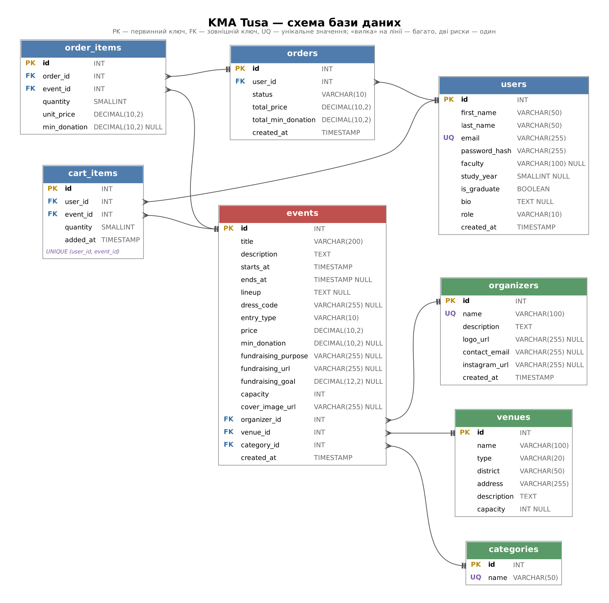

# KMA Tusa

> Афіша студентських тусовок Могилянки: вечірки, квартирники, «Бунтівники», ночі настолок і караоке. Знайди й обери, куди піти, за кілька кліків.


## Зміст

- [Про проєкт](#про-проєкт)
- [Сторінки сайту](#сторінки-сайту)
- [Ролі користувачів](#ролі-користувачів)
- [REST API](#rest-api)
  - [Загальні правила](#загальні-правила)
  - [Перелік ендпоінтів](#перелік-ендпоінтів)
  - [Автентифікація](#автентифікація)
  - [Профіль користувача](#профіль-користувача)
  - [Тусовки](#тусовки)
  - [Організатори](#організатори)
  - [Локації](#локації)
  - [Категорії](#категорії)
  - [Кошик](#кошик)
  - [Замовлення](#замовлення)
  - [Інформація про сайт](#інформація-про-сайт)
- [Схема бази даних](#схема-бази-даних)
- [TODO / TBD](#todo--tbd)
- [Плани розвитку](#плани-розвитку)
- [Автор](#автор)

## Про проєкт

Студенти Могилянки постійно влаштовують вечірки, квартирники, (колись повернеться) «Бунтівник» та інші зібрання, щоб відпочити після пар. Але дізнатися про них можна лише випадково: з історії в Instagram, з репосту в Telegram-чаті або від друга, який «чув, що в суботу щось буде». Організаторам, своєю чергою, складно зібрати людей і порахувати, скільки їх прийде.

**KMA Tusa** це одне місце для всіх студентських тусовок:

- студент бачить **афішу** найближчих тусовок, може знайти потрібну за назвою чи організатором і відфільтрувати за типом (вечірка, квартирник, настолки…), датою, локацією, умовами входу та іншими параметрами;
- на сторінці тусовки є все, що треба знати перед тим, як іти: опис, дата й час, хто грає або виступає (лайнап), дрес-код, умови входу, посилання на збір, організатори і скільки ще залишилося місць;
- більшість тусовок у Могилянці **благодійні** (вхід за донат на збір для ЗСУ чи іншої ініціативи) або **безкоштовні**, а платний квиток трапляється рідше. Тому в кожної тусовки вказано тип входу: *вільний*, *за донат* або *квиток*. Для благодійних тусовок показано мету збору й посилання на банку. Сайт сам гроші не приймає: донат робиться за посиланням на збір;
- можна переглянути **організаторів** і всі їхні тусовки;
- можна переглянути **локації** і всі тусовки, що там проходять;
- зареєстрований користувач додає квитки в **кошик** (наприклад, на кілька тусовок одразу або кілька квитків для друзів) і оформлює **замовлення**. «Квиток» тут означає місце на тусовці, а не обов'язково платний вхід. У першій версії оплати немає: натискання «Оформити» одразу створює замовлення. Безкоштовні та благодійні тусовки теж оформлюються через замовлення, щоб організатор знав, скільки людей прийде;
- у **профілі** користувач бачить історію замовлень (куди він іде і де вже був) та може редагувати дані про себе;
- адміністратор додає, редагує та видаляє тусовки, організаторів, локації й категорії.

## Сторінки сайту

| Сторінка | Що на ній є |
|---|---|
| **Афіша** (головна) | Список тусовок, пошук за назвою та організатором, фільтри (категорія, організатор, локація, район, дата, тип входу, лише благодійні), сортування (найближчі, популярні, за категорією) |
| **Сторінка тусовки** | Обкладинка, назва, опис, дата й час початку/кінця, лайнап, дрес-код, тип входу (вільний / за донат / квиток) і сума, мета збору й посилання на нього, локація, організатор, категорія, кількість вільних місць, кнопка «Додати в кошик» |
| **Організатори** | Список усіх організаторів з пошуком |
| **Сторінка організатора** | Опис, логотип, контакти, Instagram, усі тусовки цього організатора |
| **Локації** | Список місць, де проходять тусовки |
| **Сторінка локації** | Тип, район, адреса, опис, місткість, усі тусовки в цій локації |
| **Реєстрація / Вхід** | Форми реєстрації та входу |
| **Профіль** | Дані користувача (ім'я, факультет, курс/випускник, щось про себе) з можливістю редагування, історія замовлень |
| **Кошик** | Квитки, додані користувачем, зміна кількості, видалення, загальна сума за квитки та мінімальних донатів, кнопка «Оформити» |
| **Про нас** | Загальна інформація, правила відвідування, контакти |
| **Адмін-панель** | Форми додавання, редагування та видалення тусовок, організаторів, локацій, категорій |

## Ролі користувачів

| Роль | Що може |
|---|---|
| Гість | Переглядати афішу, тусовки, організаторів, локації, сторінку «Про нас»; зареєструватися або увійти |
| Користувач | Усе, що гість, а також кошик, замовлення, профіль |
| Адміністратор | Усе, що користувач, а також додавання, редагування та видалення даних |

> **TBD:** як саме перевіряти роль користувача, вирішимо на етапі додавання авторизації.

## REST API

### Загальні правила

- **Базовий URL:** `/api/v1`. Номер версії в URL дозволить змінювати API, не ламаючи старі клієнти.
- Усі дані передаються у форматі **JSON** (`Content-Type: application/json`).
- Назви ресурсів це іменники в множині (`/events`, `/organizers`), а дія визначається HTTP-методом:

  | Метод | Значення |
  |---|---|
  | `GET` | отримати дані |
  | `POST` | створити новий запис |
  | `PATCH` | частково змінити запис (передаються лише поля, які змінюються) |
  | `DELETE` | видалити запис |

- Тусовку в API називаємо `event` (англійською так зрозуміліше), а ресурс відповідно `/events`.
- Дати та час передаються у форматі ISO 8601: `"2026-11-14T21:00:00+02:00"`.
- Суми в гривнях, числом: `150`.

#### Тип входу на тусовку

Кожна тусовка має поле `entryType`, від якого залежать інші поля:

| `entryType` | Що означає | `price` | `minDonation` | `fundraising` |
|---|---|---|---|---|
| `free` | Вхід вільний | `0` | `null` | необов'язково (можна задонатити за бажанням) |
| `donation` | Вхід за донат на збір | `0` | мінімальний донат або `null`, якщо будь-який | **обов'язково** |
| `ticket` | Платний квиток | більше `0` | `null` | необов'язково (наприклад, частина коштів іде на збір) |

`fundraising` це інформація про збір:

```json
{
  "purpose": "Збір на FPV-дрони для підрозділу випускників КМА",
  "url": "https://send.monobank.ua/jar/example",
  "goalAmount": 50000
}
```

`goalAmount` (ціль збору) необов'язковий. Сайт не приймає гроші і не знає, скільки вже зібрано: донат робиться за посиланням `url`.

#### Пагінація

Списки (`GET /events`, `GET /organizers` тощо) віддаються сторінками. Параметри запиту:

| Параметр | Тип | За замовчуванням | Опис |
|---|---|---|---|
| `page` | number | `1` | Номер сторінки |
| `limit` | number | `20` | Кількість елементів на сторінці (максимум `100`) |

Формат відповіді для списків:

```json
{
  "items": [],
  "page": 1,
  "limit": 20,
  "total": 57
}
```

#### Формат помилки

У разі помилки сервер повертає відповідний статус і тіло:

```json
{
  "error": {
    "status": 400,
    "message": "Некоректні дані",
    "details": [
      { "field": "fundraising", "message": "Для тусовки за донат потрібно вказати збір" }
    ]
  }
}
```

Поле `details` є лише в помилках валідації (`400`).

#### Коди відповідей

| Код | Коли повертається |
|---|---|
| `200 OK` | Запит успішний, у відповіді є дані |
| `201 Created` | Запис створено, у відповіді створений об'єкт |
| `204 No Content` | Запит успішний, тіла відповіді немає (наприклад, після видалення) |
| `400 Bad Request` | Некоректні дані в запиті (не пройшли валідацію) |
| `401 Unauthorized` | Користувач не увійшов у систему |
| `403 Forbidden` | Користувач увійшов, але не має права на цю дію (наприклад, не адміністратор) |
| `404 Not Found` | Запис не знайдено |
| `409 Conflict` | Дію не можна виконати через поточний стан даних (email уже зайнятий, немає вільних місць тощо) |

### Перелік ендпоінтів

У колонці «Доступ»: **Усі** означає, що вхід не потрібен; **Користувач** — потрібно увійти; **Адмін** — лише адміністратор.

| Метод | Ендпоінт | Опис | Доступ |
|---|---|---|---|
| `POST` | `/auth/register` | Реєстрація | Усі |
| `POST` | `/auth/login` | Вхід | Усі |
| `POST` | `/auth/logout` | Вихід | Користувач |
| `GET` | `/users/me` | Мій профіль | Користувач |
| `PATCH` | `/users/me` | Редагування профілю | Користувач |
| `GET` | `/events` | Афіша тусовок (пошук, фільтри, сортування) | Усі |
| `GET` | `/events/{id}` | Детальна інформація про тусовку | Усі |
| `POST` | `/events` | Додати тусовку | Адмін |
| `PATCH` | `/events/{id}` | Редагувати тусовку | Адмін |
| `DELETE` | `/events/{id}` | Видалити тусовку | Адмін |
| `GET` | `/organizers` | Список організаторів | Усі |
| `GET` | `/organizers/{id}` | Інформація про організатора | Усі |
| `GET` | `/organizers/{id}/events` | Тусовки організатора | Усі |
| `POST` | `/organizers` | Додати організатора | Адмін |
| `PATCH` | `/organizers/{id}` | Редагувати організатора | Адмін |
| `DELETE` | `/organizers/{id}` | Видалити організатора | Адмін |
| `GET` | `/venues` | Список локацій | Усі |
| `GET` | `/venues/{id}` | Інформація про локацію | Усі |
| `GET` | `/venues/{id}/events` | Тусовки в локації | Усі |
| `POST` | `/venues` | Додати локацію | Адмін |
| `PATCH` | `/venues/{id}` | Редагувати локацію | Адмін |
| `DELETE` | `/venues/{id}` | Видалити локацію | Адмін |
| `GET` | `/categories` | Список категорій | Усі |
| `POST` | `/categories` | Додати категорію | Адмін |
| `PATCH` | `/categories/{id}` | Перейменувати категорію | Адмін |
| `DELETE` | `/categories/{id}` | Видалити категорію | Адмін |
| `GET` | `/cart` | Вміст мого кошика | Користувач |
| `POST` | `/cart/items` | Додати квитки в кошик | Користувач |
| `PATCH` | `/cart/items/{itemId}` | Змінити кількість квитків | Користувач |
| `DELETE` | `/cart/items/{itemId}` | Прибрати позицію з кошика | Користувач |
| `DELETE` | `/cart` | Очистити кошик | Користувач |
| `POST` | `/orders` | Оформити замовлення з кошика | Користувач |
| `GET` | `/orders` | Історія моїх замовлень | Користувач |
| `GET` | `/orders/{id}` | Деталі замовлення | Користувач |
| `PATCH` | `/orders/{id}` | Скасувати замовлення | Користувач |
| `GET` | `/info` | Дані для сторінки «Про нас» | Усі |

Нижче кожен ендпоінт описано детально (натисніть, щоб розгорнути).

---

### Автентифікація

<details>
<summary><code>POST /auth/register</code> — реєстрація нового користувача</summary>

**Використання:** форма реєстрації.

**Request body:**

```json
{
  "firstName": "Олена",
  "lastName": "Коваль",
  "email": "olena.koval@ukma.edu.ua",
  "password": "MyStrongPass123",
  "faculty": "ФІ",
  "studyYear": 2,
  "isGraduate": false
}
```

Обов'язкові поля: `firstName`, `lastName`, `email`, `password`. Для випускника передається `"isGraduate": true` і `"studyYear": null`.

**Responses:**

`201 Created`

```json
{
  "id": 7,
  "firstName": "Олена",
  "lastName": "Коваль",
  "email": "olena.koval@ukma.edu.ua",
  "faculty": "ФІ",
  "studyYear": 2,
  "isGraduate": false,
  "bio": null,
  "role": "user",
  "createdAt": "2026-10-20T14:05:00+03:00"
}
```

| Статус | Коли |
|---|---|
| `400 Bad Request` | Не заповнені обов'язкові поля, некоректний email, закороткий пароль, `studyYear` не від 1 до 6, вказано і курс, і `isGraduate: true` |
| `409 Conflict` | Користувач з таким email уже існує |

</details>

<details>
<summary><code>POST /auth/login</code> — вхід</summary>

**Використання:** форма входу.

**Request body:**

```json
{
  "email": "olena.koval@ukma.edu.ua",
  "password": "MyStrongPass123"
}
```

**Responses:**

`200 OK`

```json
{
  "user": {
    "id": 7,
    "firstName": "Олена",
    "lastName": "Коваль",
    "email": "olena.koval@ukma.edu.ua",
    "role": "user"
  }
}
```

| Статус | Коли |
|---|---|
| `400 Bad Request` | Не передано email або пароль |
| `401 Unauthorized` | Неправильний email або пароль |

> **TBD:** як клієнт підтверджуватиме, що він увійшов (токен у відповіді чи сесія в cookie), вирішимо на етапі авторизації.

</details>

<details>
<summary><code>POST /auth/logout</code> — вихід</summary>

**Використання:** кнопка «Вийти» в профілі.

**Request body:** немає.

**Responses:**

| Статус | Коли |
|---|---|
| `204 No Content` | Користувач вийшов |
| `401 Unauthorized` | Користувач не був авторизований |

</details>

---

### Профіль користувача

<details>
<summary><code>GET /users/me</code> — мій профіль</summary>

**Використання:** сторінка профілю.

**Responses:**

`200 OK`

```json
{
  "id": 7,
  "firstName": "Олена",
  "lastName": "Коваль",
  "email": "olena.koval@ukma.edu.ua",
  "faculty": "ФІ",
  "studyYear": 2,
  "isGraduate": false,
  "bio": "Люблю квартирники і настолки, граю на укулеле",
  "role": "user",
  "createdAt": "2026-10-20T14:05:00+03:00"
}
```

| Статус | Коли |
|---|---|
| `401 Unauthorized` | Користувач не увійшов |

</details>

<details>
<summary><code>PATCH /users/me</code> — редагування профілю</summary>

**Використання:** форма редагування профілю. Передаються лише поля, які змінюються.

**Request body:**

```json
{
  "bio": "Люблю квартирники і настолки, граю на укулеле",
  "studyYear": 3
}
```

Можна змінити: `firstName`, `lastName`, `faculty`, `studyYear`, `isGraduate`, `bio`.

**Responses:**

`200 OK` — оновлений профіль (як у `GET /users/me`).

| Статус | Коли |
|---|---|
| `400 Bad Request` | Некоректні дані (наприклад, `studyYear` не від 1 до 6 або `bio` довше за 500 символів) |
| `401 Unauthorized` | Користувач не увійшов |

> **TBD:** зміна email і пароля, окремими ендпоінтами разом з авторизацією.

</details>

---

### Тусовки

<details>
<summary><code>GET /events</code> — афіша тусовок з пошуком, фільтрами та сортуванням</summary>

**Використання:** головна сторінка (афіша).

**Query-параметри (усі необов'язкові):**

| Параметр | Тип | Опис | Приклад |
|---|---|---|---|
| `search` | string | Пошук за назвою тусовки або назвою організатора | `halloween` |
| `categoryId` | number | Фільтр за категорією (вечірка, квартирник…) | `1` |
| `organizerId` | number | Фільтр за організатором | `3` |
| `venueId` | number | Фільтр за локацією | `2` |
| `district` | string | Фільтр за районом | `Поділ` |
| `dateFrom` | date | Тусовки, що починаються не раніше цієї дати | `2026-11-01` |
| `dateTo` | date | Тусовки, що починаються не пізніше цієї дати | `2026-11-30` |
| `entryType` | string | Тип входу: `free`, `donation` або `ticket` | `free` |
| `hasFundraising` | boolean | Лише благодійні тусовки (зі збором) | `true` |
| `includePast` | boolean | Показувати також минулі тусовки (за замовчуванням `false`) | `true` |
| `sort` | string | `date` (найближчі спочатку, за замовчуванням), `popularity`, `category` | `popularity` |
| `page`, `limit` | number | Пагінація | `1`, `20` |

Приклад запиту:

```
GET /api/v1/events?categoryId=1&hasFundraising=true&sort=popularity&page=1&limit=20
```

Популярність (`popularity`) рахується за кількістю оформлених квитків.

**Responses:**

`200 OK`

```json
{
  "items": [
    {
      "id": 12,
      "title": "Halloween Party: Могилянська ніч жахів",
      "startsAt": "2026-10-31T21:00:00+02:00",
      "entryType": "donation",
      "price": 0,
      "minDonation": 200,
      "hasFundraising": true,
      "coverImageUrl": "https://example.com/covers/12.jpg",
      "availableSpots": 34,
      "category": { "id": 1, "name": "Вечірка" },
      "organizer": { "id": 3, "name": "Kyiv-Mohyla Party Crew" },
      "venue": { "id": 1, "name": "Лофт «Цех»", "district": "Поділ" }
    }
  ],
  "page": 1,
  "limit": 20,
  "total": 1
}
```

| Статус | Коли |
|---|---|
| `400 Bad Request` | Некоректне значення параметра (наприклад, `sort=abc`, `entryType=vip` або `dateFrom` пізніше за `dateTo`) |

</details>

<details>
<summary><code>GET /events/{id}</code> — детальна інформація про тусовку</summary>

**Використання:** сторінка тусовки.

**Path-параметри:** `id` — ідентифікатор тусовки.

**Responses:**

`200 OK`

```json
{
  "id": 12,
  "title": "Halloween Party: Могилянська ніч жахів",
  "description": "Костюмована вечірка з конкурсом на найстрашніший образ. Усі донати йдуть на збір.",
  "startsAt": "2026-10-31T21:00:00+02:00",
  "endsAt": "2026-11-01T03:00:00+02:00",
  "lineup": "DJ Ворон, DJ Pumpkin",
  "dressCode": "Костюм обов'язковий",
  "entryType": "donation",
  "price": 0,
  "minDonation": 200,
  "fundraising": {
    "purpose": "Збір на FPV-дрони для підрозділу випускників КМА",
    "url": "https://send.monobank.ua/jar/example",
    "goalAmount": 50000
  },
  "capacity": 120,
  "ticketsTaken": 86,
  "availableSpots": 34,
  "coverImageUrl": "https://example.com/covers/12.jpg",
  "category": { "id": 1, "name": "Вечірка" },
  "organizer": {
    "id": 3,
    "name": "Kyiv-Mohyla Party Crew",
    "logoUrl": "https://example.com/logos/3.png"
  },
  "venue": {
    "id": 1,
    "name": "Лофт «Цех»",
    "type": "loft",
    "district": "Поділ",
    "address": "вул. Набережно-Лугова, 8"
  },
  "createdAt": "2026-10-01T10:00:00+03:00"
}
```

Для тусовки без збору `fundraising` дорівнює `null`.

| Статус | Коли |
|---|---|
| `404 Not Found` | Тусовки з таким `id` не існує |

</details>

<details>
<summary><code>POST /events</code> — додати тусовку</summary>

**Використання:** адмін-панель, форма створення тусовки.

**Request body** (приклад безкоштовного квартирника з необов'язковим збором):

```json
{
  "title": "Квартирник: акустика при свічках",
  "description": "Камерний вечір живої музики: три акустичні сети, чай і розмови до ночі.",
  "startsAt": "2026-11-21T19:00:00+02:00",
  "endsAt": "2026-11-21T23:00:00+02:00",
  "lineup": "Гурт «Сірий кіт», Марта Ліщук (гітара, вокал)",
  "dressCode": "Вільний",
  "entryType": "free",
  "fundraising": {
    "purpose": "Збір на теплові приціли",
    "url": "https://send.monobank.ua/jar/example2",
    "goalAmount": null
  },
  "capacity": 25,
  "coverImageUrl": "https://example.com/covers/14.jpg",
  "categoryId": 2,
  "organizerId": 4,
  "venueId": 2
}
```

Приклад для платної тусовки: `"entryType": "ticket", "price": 100` (без `fundraising` або з ним).

Обов'язкові поля: `title`, `startsAt`, `entryType`, `capacity`, `categoryId`, `organizerId`, `venueId`, а також поля, яких вимагає тип входу (див. [Тип входу на тусовку](#тип-входу-на-тусовку)).

**Responses:**

`201 Created` — створена тусовка (як у `GET /events/{id}`).

| Статус | Коли |
|---|---|
| `400 Bad Request` | Не заповнені обов'язкові поля, `endsAt` раніше за `startsAt`, `capacity` ≤ 0, поля не відповідають типу входу (наприклад, `ticket` без ціни або `donation` без збору), некоректне посилання на збір, не існує категорії, організатора чи локації з указаним id |
| `401 Unauthorized` | Користувач не увійшов |
| `403 Forbidden` | Користувач не адміністратор |

</details>

<details>
<summary><code>PATCH /events/{id}</code> — редагувати тусовку</summary>

**Використання:** адмін-панель, форма редагування тусовки. Передаються лише поля, які змінюються.

**Request body:**

```json
{
  "startsAt": "2026-10-31T22:00:00+02:00",
  "lineup": "DJ Ворон, DJ Pumpkin, special guest",
  "minDonation": 150
}
```

Можна змінити будь-яке поле з `POST /events`. Якщо змінюється `entryType`, треба передати й поля, яких вимагає новий тип.

**Responses:**

`200 OK` — оновлена тусовка (як у `GET /events/{id}`).

| Статус | Коли |
|---|---|
| `400 Bad Request` | Некоректні дані |
| `401 Unauthorized` | Користувач не увійшов |
| `403 Forbidden` | Користувач не адміністратор |
| `404 Not Found` | Тусовки не існує |
| `409 Conflict` | Нова `capacity` менша, ніж кількість уже оформлених квитків |

</details>

<details>
<summary><code>DELETE /events/{id}</code> — видалити тусовку</summary>

**Використання:** адмін-панель, кнопка «Видалити».

**Responses:**

| Статус | Коли |
|---|---|
| `204 No Content` | Тусовку видалено |
| `401 Unauthorized` | Користувач не увійшов |
| `403 Forbidden` | Користувач не адміністратор |
| `404 Not Found` | Тусовки не існує |
| `409 Conflict` | На тусовку вже є замовлення, тому її не можна видалити |

> **TBD:** замість видалення тусовки з оформленими квитками додати статус «Скасовано».

</details>

---

### Організатори

<details>
<summary><code>GET /organizers</code> — список організаторів</summary>

**Використання:** сторінка «Організатори», випадний список у фільтрі на афіші.

**Query-параметри:**

| Параметр | Тип | Опис |
|---|---|---|
| `search` | string | Пошук за назвою |
| `page`, `limit` | number | Пагінація |

**Responses:**

`200 OK`

```json
{
  "items": [
    {
      "id": 3,
      "name": "Kyiv-Mohyla Party Crew",
      "logoUrl": "https://example.com/logos/3.png",
      "upcomingEventsCount": 4
    }
  ],
  "page": 1,
  "limit": 20,
  "total": 1
}
```

</details>

<details>
<summary><code>GET /organizers/{id}</code> — інформація про організатора</summary>

**Використання:** верхня частина сторінки організатора.

**Responses:**

`200 OK`

```json
{
  "id": 3,
  "name": "Kyiv-Mohyla Party Crew",
  "description": "Студентська команда, яка робить тематичні благодійні вечірки щомісяця.",
  "logoUrl": "https://example.com/logos/3.png",
  "contactEmail": "partycrew@example.com",
  "instagramUrl": "https://instagram.com/kma_party_crew",
  "createdAt": "2026-09-01T12:00:00+03:00"
}
```

| Статус | Коли |
|---|---|
| `404 Not Found` | Організатора не існує |

</details>

<details>
<summary><code>GET /organizers/{id}/events</code> — усі тусовки організатора</summary>

**Використання:** список тусовок на сторінці організатора. Результат той самий, що й `GET /events?organizerId={id}`, але URL показує, що тусовки належать організатору.

**Query-параметри:** `sort`, `includePast`, `page`, `limit` (так само, як у `GET /events`).

**Responses:**

`200 OK` — список тусовок у тому ж форматі, що й `GET /events`.

| Статус | Коли |
|---|---|
| `404 Not Found` | Організатора не існує |

</details>

<details>
<summary><code>POST /organizers</code> — додати організатора</summary>

**Використання:** адмін-панель.

**Request body:**

```json
{
  "name": "Kyiv-Mohyla Party Crew",
  "description": "Студентська команда, яка робить тематичні благодійні вечірки щомісяця.",
  "logoUrl": "https://example.com/logos/3.png",
  "contactEmail": "partycrew@example.com",
  "instagramUrl": "https://instagram.com/kma_party_crew"
}
```

Обов'язкове поле: `name`.

**Responses:**

`201 Created` — створений організатор (як у `GET /organizers/{id}`).

| Статус | Коли |
|---|---|
| `400 Bad Request` | Не вказано `name`, некоректний email |
| `401 Unauthorized` | Користувач не увійшов |
| `403 Forbidden` | Користувач не адміністратор |
| `409 Conflict` | Організатор з такою назвою вже існує |

</details>

<details>
<summary><code>PATCH /organizers/{id}</code> — редагувати організатора</summary>

**Використання:** адмін-панель. Передаються лише поля, які змінюються.

**Request body:**

```json
{
  "instagramUrl": "https://instagram.com/kma_party_crew_official"
}
```

**Responses:**

`200 OK` — оновлений організатор.

| Статус | Коли |
|---|---|
| `400 Bad Request` | Некоректні дані |
| `401 Unauthorized` | Користувач не увійшов |
| `403 Forbidden` | Користувач не адміністратор |
| `404 Not Found` | Організатора не існує |
| `409 Conflict` | Нова назва вже зайнята |

</details>

<details>
<summary><code>DELETE /organizers/{id}</code> — видалити організатора</summary>

**Використання:** адмін-панель.

**Responses:**

| Статус | Коли |
|---|---|
| `204 No Content` | Організатора видалено |
| `401 Unauthorized` | Користувач не увійшов |
| `403 Forbidden` | Користувач не адміністратор |
| `404 Not Found` | Організатора не існує |
| `409 Conflict` | В організатора є тусовки, спершу їх треба видалити або передати іншому організатору |

</details>

---

### Локації

Тип локації (`type`) може бути: `club`, `bar`, `loft`, `apartment`, `outdoor`, `campus`, `other`.

<details>
<summary><code>GET /venues</code> — список локацій</summary>

**Використання:** сторінка «Локації», випадний список у фільтрі на афіші.

**Query-параметри:**

| Параметр | Тип | Опис |
|---|---|---|
| `search` | string | Пошук за назвою або адресою |
| `type` | string | Фільтр за типом локації |
| `district` | string | Фільтр за районом |
| `page`, `limit` | number | Пагінація |

**Responses:**

`200 OK`

```json
{
  "items": [
    {
      "id": 1,
      "name": "Лофт «Цех»",
      "type": "loft",
      "district": "Поділ",
      "upcomingEventsCount": 3
    }
  ],
  "page": 1,
  "limit": 20,
  "total": 1
}
```

</details>

<details>
<summary><code>GET /venues/{id}</code> — інформація про локацію</summary>

**Використання:** верхня частина сторінки локації.

**Responses:**

`200 OK`

```json
{
  "id": 1,
  "name": "Лофт «Цех»",
  "type": "loft",
  "district": "Поділ",
  "address": "вул. Набережно-Лугова, 8",
  "description": "Простора індустріальна зала з баром і танцполом.",
  "capacity": 200
}
```

| Статус | Коли |
|---|---|
| `404 Not Found` | Локації не існує |

</details>

<details>
<summary><code>GET /venues/{id}/events</code> — усі тусовки в локації</summary>

**Використання:** список тусовок на сторінці локації.

**Query-параметри:** `sort`, `includePast`, `page`, `limit` (так само, як у `GET /events`).

**Responses:**

`200 OK` — список тусовок у тому ж форматі, що й `GET /events`.

| Статус | Коли |
|---|---|
| `404 Not Found` | Локації не існує |

</details>

<details>
<summary><code>POST /venues</code> — додати локацію</summary>

**Використання:** адмін-панель.

**Request body:**

```json
{
  "name": "Лофт «Цех»",
  "type": "loft",
  "district": "Поділ",
  "address": "вул. Набережно-Лугова, 8",
  "description": "Простора індустріальна зала з баром і танцполом.",
  "capacity": 200
}
```

Обов'язкові поля: `name`, `type`, `district`, `address`.

**Responses:**

`201 Created` — створена локація (як у `GET /venues/{id}`).

| Статус | Коли |
|---|---|
| `400 Bad Request` | Не заповнені обов'язкові поля, невідомий `type`, `capacity` ≤ 0 |
| `401 Unauthorized` | Користувач не увійшов |
| `403 Forbidden` | Користувач не адміністратор |

</details>

<details>
<summary><code>PATCH /venues/{id}</code> — редагувати локацію</summary>

**Використання:** адмін-панель. Передаються лише поля, які змінюються.

**Request body:**

```json
{
  "capacity": 220
}
```

**Responses:**

`200 OK` — оновлена локація.

| Статус | Коли |
|---|---|
| `400 Bad Request` | Некоректні дані |
| `401 Unauthorized` | Користувач не увійшов |
| `403 Forbidden` | Користувач не адміністратор |
| `404 Not Found` | Локації не існує |

</details>

<details>
<summary><code>DELETE /venues/{id}</code> — видалити локацію</summary>

**Використання:** адмін-панель.

**Responses:**

| Статус | Коли |
|---|---|
| `204 No Content` | Локацію видалено |
| `401 Unauthorized` | Користувач не увійшов |
| `403 Forbidden` | Користувач не адміністратор |
| `404 Not Found` | Локації не існує |
| `409 Conflict` | У локації заплановані тусовки |

</details>

---

### Категорії

<details>
<summary><code>GET /categories</code> — список категорій</summary>

**Використання:** фільтр за категорією на афіші, вибір категорії у формі тусовки.

**Responses:**

`200 OK` (без пагінації, бо категорій небагато)

```json
[
  { "id": 1, "name": "Вечірка" },
  { "id": 2, "name": "Квартирник" },
  { "id": 3, "name": "Ніч настолок" },
  { "id": 4, "name": "Караоке" },
  { "id": 5, "name": "Кіновечір" },
  { "id": 6, "name": "Пікнік" }
]
```

</details>

<details>
<summary><code>POST /categories</code> — додати категорію</summary>

**Використання:** адмін-панель.

**Request body:**

```json
{
  "name": "Стендап"
}
```

**Responses:**

`201 Created`

```json
{ "id": 7, "name": "Стендап" }
```

| Статус | Коли |
|---|---|
| `400 Bad Request` | Порожня назва |
| `401 Unauthorized` | Користувач не увійшов |
| `403 Forbidden` | Користувач не адміністратор |
| `409 Conflict` | Категорія з такою назвою вже існує |

</details>

<details>
<summary><code>PATCH /categories/{id}</code> — перейменувати категорію</summary>

**Використання:** адмін-панель.

**Request body:**

```json
{
  "name": "Стендап і open mic"
}
```

**Responses:**

`200 OK` — оновлена категорія.

| Статус | Коли |
|---|---|
| `400 Bad Request` | Порожня назва |
| `401 Unauthorized` | Користувач не увійшов |
| `403 Forbidden` | Користувач не адміністратор |
| `404 Not Found` | Категорії не існує |
| `409 Conflict` | Категорія з такою назвою вже існує |

</details>

<details>
<summary><code>DELETE /categories/{id}</code> — видалити категорію</summary>

**Використання:** адмін-панель.

**Responses:**

| Статус | Коли |
|---|---|
| `204 No Content` | Категорію видалено |
| `401 Unauthorized` | Користувач не увійшов |
| `403 Forbidden` | Користувач не адміністратор |
| `404 Not Found` | Категорії не існує |
| `409 Conflict` | У категорії є тусовки |

</details>

---

### Кошик

Кошик належить користувачу, який увійшов, тому в URL немає id користувача. У кошику можуть одночасно лежати квитки на безкоштовні, благодійні та платні тусовки.

<details>
<summary><code>GET /cart</code> — вміст мого кошика</summary>

**Використання:** сторінка «Кошик», лічильник біля іконки кошика.

**Responses:**

`200 OK`

```json
{
  "items": [
    {
      "id": 41,
      "quantity": 2,
      "event": {
        "id": 12,
        "title": "Halloween Party: Могилянська ніч жахів",
        "startsAt": "2026-10-31T21:00:00+02:00",
        "entryType": "donation",
        "price": 0,
        "minDonation": 200,
        "availableSpots": 34
      },
      "subtotal": 0,
      "subtotalMinDonation": 400
    },
    {
      "id": 42,
      "quantity": 1,
      "event": {
        "id": 16,
        "title": "Ніч настолок у «Лігві»",
        "startsAt": "2026-11-07T18:00:00+02:00",
        "entryType": "ticket",
        "price": 100,
        "minDonation": null,
        "availableSpots": 12
      },
      "subtotal": 100,
      "subtotalMinDonation": 0
    }
  ],
  "totalQuantity": 3,
  "totalPrice": 100,
  "totalMinDonation": 400
}
```

- `totalPrice` — сума за платні квитки.
- `totalMinDonation` — сума мінімальних донатів на благодійні тусовки (донат робиться окремо за посиланням на збір).

| Статус | Коли |
|---|---|
| `401 Unauthorized` | Користувач не увійшов |

</details>

<details>
<summary><code>POST /cart/items</code> — додати квитки в кошик</summary>

**Використання:** кнопка «Додати в кошик» на сторінці тусовки.

**Request body:**

```json
{
  "eventId": 12,
  "quantity": 2
}
```

`quantity` від 1 до 5 (обмеження, щоб одна людина не забрала всі місця).

**Responses:**

`201 Created` — додана позиція кошика (у форматі елемента з `GET /cart`).

```json
{
  "id": 41,
  "quantity": 2,
  "event": {
    "id": 12,
    "title": "Halloween Party: Могилянська ніч жахів",
    "startsAt": "2026-10-31T21:00:00+02:00",
    "entryType": "donation",
    "price": 0,
    "minDonation": 200,
    "availableSpots": 34
  },
  "subtotal": 0,
  "subtotalMinDonation": 400
}
```

| Статус | Коли |
|---|---|
| `400 Bad Request` | Некоректна кількість, тусовка вже минула |
| `401 Unauthorized` | Користувач не увійшов |
| `404 Not Found` | Тусовки не існує |
| `409 Conflict` | Тусовка вже є в кошику (тоді треба змінити кількість через `PATCH`) або недостатньо вільних місць |

</details>

<details>
<summary><code>PATCH /cart/items/{itemId}</code> — змінити кількість квитків</summary>

**Використання:** кнопки «+» / «−» у кошику.

**Request body:**

```json
{
  "quantity": 3
}
```

**Responses:**

`200 OK` — оновлена позиція кошика.

| Статус | Коли |
|---|---|
| `400 Bad Request` | Кількість не від 1 до 5 |
| `401 Unauthorized` | Користувач не увійшов |
| `404 Not Found` | Позиції немає в кошику цього користувача |
| `409 Conflict` | Недостатньо вільних місць |

</details>

<details>
<summary><code>DELETE /cart/items/{itemId}</code> — прибрати позицію з кошика</summary>

**Використання:** кнопка «Видалити» біля позиції в кошику.

**Responses:**

| Статус | Коли |
|---|---|
| `204 No Content` | Позицію видалено |
| `401 Unauthorized` | Користувач не увійшов |
| `404 Not Found` | Позиції немає в кошику цього користувача |

</details>

<details>
<summary><code>DELETE /cart</code> — очистити кошик</summary>

**Використання:** кнопка «Очистити кошик».

**Responses:**

| Статус | Коли |
|---|---|
| `204 No Content` | Кошик очищено |
| `401 Unauthorized` | Користувач не увійшов |

</details>

---

### Замовлення

<details>
<summary><code>POST /orders</code> — оформити замовлення з кошика</summary>

**Використання:** кнопка «Оформити» в кошику. Сервер бере всі позиції з кошика користувача, створює з них замовлення і очищує кошик. Оплати поки немає. Після оформлення користувач бачить посилання на збори, щоб одразу задонатити.

**Request body:** немає.

**Responses:**

`201 Created`

```json
{
  "id": 105,
  "status": "created",
  "createdAt": "2026-10-20T15:30:00+03:00",
  "totalPrice": 100,
  "totalMinDonation": 400,
  "items": [
    {
      "eventId": 12,
      "title": "Halloween Party: Могилянська ніч жахів",
      "startsAt": "2026-10-31T21:00:00+02:00",
      "venueName": "Лофт «Цех»",
      "entryType": "donation",
      "quantity": 2,
      "unitPrice": 0,
      "minDonation": 200,
      "fundraisingUrl": "https://send.monobank.ua/jar/example"
    },
    {
      "eventId": 16,
      "title": "Ніч настолок у «Лігві»",
      "startsAt": "2026-11-07T18:00:00+02:00",
      "venueName": "Антикафе «Лігво»",
      "entryType": "ticket",
      "quantity": 1,
      "unitPrice": 100,
      "minDonation": null,
      "fundraisingUrl": null
    }
  ]
}
```

`unitPrice` і `minDonation` фіксуються на момент оформлення: якщо адміністратор потім змінить суми, у старих замовленнях вони не зміняться.

| Статус | Коли |
|---|---|
| `400 Bad Request` | Кошик порожній або одна з тусовок уже минула |
| `401 Unauthorized` | Користувач не увійшов |
| `409 Conflict` | Поки квитки лежали в кошику, вільні місця на одну з тусовок закінчилися |

</details>

<details>
<summary><code>GET /orders</code> — історія моїх замовлень</summary>

**Використання:** розділ «Мої замовлення» у профілі.

**Query-параметри:**

| Параметр | Тип | Опис |
|---|---|---|
| `status` | string | `created` або `cancelled` |
| `page`, `limit` | number | Пагінація |

Замовлення відсортовані від найновіших.

**Responses:**

`200 OK`

```json
{
  "items": [
    {
      "id": 105,
      "status": "created",
      "createdAt": "2026-10-20T15:30:00+03:00",
      "totalPrice": 100,
      "totalMinDonation": 400,
      "itemsCount": 2
    }
  ],
  "page": 1,
  "limit": 20,
  "total": 1
}
```

| Статус | Коли |
|---|---|
| `401 Unauthorized` | Користувач не увійшов |

</details>

<details>
<summary><code>GET /orders/{id}</code> — деталі замовлення</summary>

**Використання:** перегляд конкретного замовлення в профілі: на які тусовки, скільки квитків і посилання на збори.

**Responses:**

`200 OK` — замовлення в тому ж форматі, що й у відповіді `POST /orders`.

| Статус | Коли |
|---|---|
| `401 Unauthorized` | Користувач не увійшов |
| `404 Not Found` | Замовлення не існує або воно належить іншому користувачу |

</details>

<details>
<summary><code>PATCH /orders/{id}</code> — скасувати замовлення</summary>

**Використання:** кнопка «Скасувати» у деталях замовлення (якщо плани змінилися). Після скасування місця знову стають вільними.

**Request body:**

```json
{
  "status": "cancelled"
}
```

Поки що змінювати можна лише статус і лише на `cancelled`.

**Responses:**

`200 OK` — замовлення з оновленим статусом.

| Статус | Коли |
|---|---|
| `400 Bad Request` | Передано інший статус |
| `401 Unauthorized` | Користувач не увійшов |
| `404 Not Found` | Замовлення не існує або воно належить іншому користувачу |
| `409 Conflict` | Замовлення вже скасоване або одна з тусовок уже почалася |

</details>

---

### Інформація про сайт

<details>
<summary><code>GET /info</code> — дані для сторінки «Про нас»</summary>

**Використання:** сторінка «Про нас».

**Responses:**

`200 OK`

```json
{
  "about": "KMA Tusa — афіша студентських тусовок Могилянки: вечірки, квартирники та інші зібрання для відпочинку. Більшість тусовок благодійні або безкоштовні.",
  "visitRules": "Квиток прив'язаний до акаунту, на вході достатньо назвати ім'я. Якщо тусовка за донат, покажи на вході підтвердження донату на збір.",
  "contacts": {
    "email": "hello@example.com",
    "telegram": "https://t.me/kma_tusa",
    "instagram": "https://instagram.com/kma_tusa"
  }
}
```

> **TBD:** редагування цієї інформації з адмін-панелі (`PATCH /info`).

</details>

## Схема бази даних



| Таблиця | Що зберігає |
|---|---|
| `users` | Зареєстровані користувачі та адміністратори (поле `role`). Курс або позначка «випускник», коротко про себе |
| `organizers` | Організатори тусовок |
| `venues` | Локації: тип, район, адреса |
| `categories` | Типи тусовок (вечірка, квартирник…) |
| `events` | Тусовки. Кожна має одного організатора, одну категорію та одну локацію. Тип входу (`entry_type`), ціна, мінімальний донат і дані збору (`fundraising_*`) |
| `cart_items` | Кошик: на які тусовки і скільки квитків користувач відклав. Пара `user_id` + `event_id` унікальна |
| `orders` | Замовлення користувача: статус, сума за квитки, сума мінімальних донатів, дата створення |
| `order_items` | Позиції замовлення: тусовка, кількість квитків, ціна та мінімальний донат на момент оформлення |

**Зв'язки:**

- `organizers` 1 — N `events`
- `venues` 1 — N `events`
- `categories` 1 — N `events`
- `users` 1 — N `cart_items`, `events` 1 — N `cart_items`
- `users` 1 — N `orders`
- `orders` 1 — N `order_items`, `events` 1 — N `order_items`

Кількість вільних місць не зберігається окремо, а рахується: `capacity` мінус сума `quantity` в `order_items` нескасованих замовлень. Так само рахується популярність тусовки.

Дані збору зберігаються прямо в таблиці `events`, бо в однієї тусовки максимум один збір. Якщо колись знадобиться один збір на кілька тусовок, їх можна буде винести в окрему таблицю.

Файл-джерело діаграми для draw.io: [`docs/db-schema.drawio`](docs/db-schema.drawio).

## TODO / TBD

- [ ] **TBD:** спосіб автентифікації (токен чи сесія) та перевірка ролей, на етапі додавання авторизації.
- [ ] **TBD:** зміна email і пароля, відновлення пароля.
- [ ] **TBD:** статус «Скасовано» для тусовок замість видалення.
- [ ] **TBD:** чи показувати прогрес збору (скільки вже зібрано), для цього треба брати дані з банку.
- [ ] **TODO:** завантаження зображень (обкладинки, логотипи) файлом, а не посиланням.

## Плани розвитку

- [x] Тема сайту, архітектура REST API, схема БД
- [ ] Основний функціонал (тусовки, організатори, локації, категорії, кошик, замовлення)
- [ ] Авторизація
- [ ] Тести
- [ ] Ідеї для командного проєкту: акаунти організаторів (кожна тусовочна команда сама публікує свої івенти), окрема сторінка збору з усіма тусовками на нього, список гостей для організатора, «я піду» і друзі, які теж ідуть, відгуки й фото після тусовки, QR-квитки

## Автор

Юрій Бобровник
